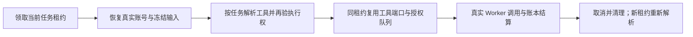

# T-915：聊天调度器按任务解析工具

createChatWorkerDispatcher 支持静态 tools 或动态 resolveTools 二选一。动态解析前经真实租约与 AI 任务映射恢复账号和冻结输入；解析后再次核验当前执行权和全部工具是否已装配。每个 executionTaskId/attempt/fenceToken 范围只缓存一次工具端口实例，授权检查仍逐次执行，不缓存用户决定。

解析器只构造端口并接收取消信号。即便解析器不响应取消，宿主也不等待它无限返回；迟到解析只被接收清理，不能进入凭据解析或模型执行。原执行已存在 started/unknown 调用时，解析失败保留 unknown_result，不改成可自动重跑的失败。旧静态路径仍可用。

测试为正式构建的 Worker 二进制与真实后端服务，模型供应商使用本机 HTTP fixture：4 个新动态用例先出现真实红测（4 fail / 14 skipped），实现后覆盖正常工具、授权等待及三次租约恢复、缺失工具和解析异常。又补取消、host.stop、暂停后旧解析迟到，以及已有 started 调用时恢复解析失败。最终完整 Worker suite 24 项、原模型调度与聊天服务回归 33 项，共 57 项通过，前后端类型检查通过。未调用商业模型或用户数据库。

原授权串行队列、工具账本、投影和终态服务继续复用；只将共用的租约/AI 映射读取提取为 readExecutionChatTask。工具副作用没有被迁回宿主。正式应用组合根尚未配置动态解析器，本批也未迁完模型、浏览器工具或公共聊天入口；完整 T-915 范围保持。

独立复核发现两个具体遗漏，并先补当场红测：host.stop 导致无调用任务被误记 failed（1 fail）；未返回 resolver 过截止时间仍占执行槽（1 fail）。修复后，退出前后两次检查 stopping，正常退出保留 running，租约到期后能真实回收为 queued；初始化持久预算后，chatReady 前每次控制轮询执行 admission 校验，截止或租约到期会中断解析。恢复测试将截止时间设为长于租约，分别证明租约回收与原截止时间约束，不延长产品中的任务 deadline。

独立复核确认两项主路径修复，最后建议的写前 stopping 检查也已落实，最终 24 项 Worker 用例与类型检查通过；评审者未独立重跑。边界仍为既有 5 条，orphan 为 0 errors / 100 warnings，范围与复杂度检查通过，CodeGraph 刷新。pmem sync 完成，全局 reconcile 本轮仍为 211 errors / 1 warning，未通过；T-915 不据局部测试完成。
