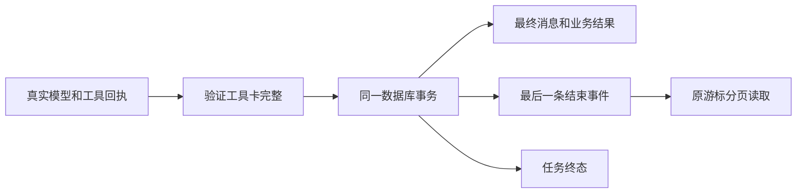

# T-915：完成事件与聊天结果一起保存

任务完成后，持久流此前没有 finish，订阅恢复缺少明确收尾。本批由后端使用真实回执的结束原因和最终消息 metadata 写入 finish，与消息、业务结果、调用引用和任务终态共享事务。Worker 仍无自行宣告完成的事件写入权。

finish 的 sequence 取任务尾部，callIndex 取最后模型调用尾部。重复完成验证事件内容、归属与末尾位置，不重复写入。工具结算与卡片保存之间若收到提前完成请求，保持原任务 running 并拒绝提前结束；补卡后沿原调用继续。工具投影禁止在 finish 后首次追加新卡。

独立审查指出旧已完成工具回复可能没有事件。修复为先验证原消息、结果和账本，再在同一事务内依据这些确认事实补工具卡和结束事件；不重新执行工具，不创建第二份业务结果。已有结束事件或卡片被篡改仍拒绝伪幂等成功。

红测当场观察到缺少 finish 与篡改结束事件后仍回放成功。修复后 4 文件 67 项通过：正式 Worker 14、权限和卡片 17、最终消息 30、事件服务 6。覆盖并发完成、结束更新失败全事务回滚、缺卡与完成竞争、旧文本及工具回复恢复、正式 Worker 与真实 SDK reducer 的 metadata 一致，以及每页 1 条事件的订阅读取到末尾 finish。缺卡窗口通过删除事件模拟，未声称它是真实进程崩溃。

backend/frontend 类型检查通过；范围门通过，边界原有 5 条无新增，orphan 0 errors / 100 warnings。独立 worker_review 只读复审无剩余具体阻断。测试使用隔离 PGlite、本地 HTTP SSE 和正式 Worker fork，没有真实商用模型或产品页面验收。公开聊天入口与其余业务迁移尚未完成，T-915 保持进行中。

## 实际聊天入口接线核对（只读）

runtime_code_review 本轮只读盘点确认：`frontend/src/app/api/chat/route.ts` 仍调用 `runChatStream`，`persistence-client.ts` 尚未装配 chat submission/dispatcher。`getChatRuntime` 也供知识搜索路由使用，不能整体删除。

后续实现应复用 `buildChatAssembly` 的 CreativeContext、surface 白名单、可信选区、抖音专路及强制工具顺序，先分离其主模型凭据解析。真实工具定义还需保留可校验参数 schema、登记 version/effect、将旧卡片输出完整置于 ToolOutcome.data。网页读取暂存素材、截图及异步建任务不能一律声明无副作用；旧工具 catch 也不能把未知提交包装成确定失败。

宿主授权应复用 `getChatToolApprovalDecider` 并将检查异常视为 unavailable，不能沿用旧聚合函数异常时返回 not-applicable 的行为。工具闭包不能跨账号共享或依赖某次请求内存；恢复须绑定持久的可信上下文与 Skill 快照。备用模型、真实 usage/模型名、中断输出、附件转换、script.patch 可信锚点与唯一 assistant 落库方均须保留。

旧 assembly 中 `topic.enrich`、`calibration.diagnose`、`review.insights`、`positioning.generate` 等仍有同步模型调用，浏览器工具仍有宿主长操作。整体包装旧 execute 不能证明迁移到独立 Worker。这些缺口属于既有 T-915 完整范围，本批没有宣称已完成。

最终全局 reconcile 为 211 errors / 1 warning，exit 1，与前批相同。既有欠债由 T-916 跟踪，未记全绿。
