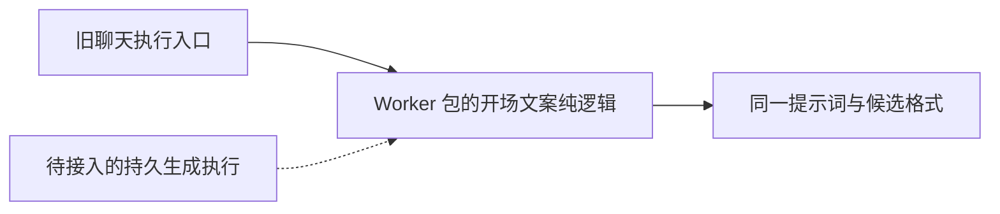

# T-915：开场文案纯逻辑迁入 Worker

将 script.hooks 的提示词、宽容 JSON 解析、非破坏式可溯标注移到 ai-worker 的 chat 模块；旧 chat-runner 调用并重新导出同一实现。此次移除宿主内重复实现，为同一 Worker 内执行生成工具提供可复用逻辑。未改变模型调用位置，公共聊天仍使用旧执行入口，不能视为生成工具迁移完成。

前置测试因 Worker 模块不存在而导入失败（1 failed、no tests），这是模块迁移红测，不是行为断言红测。实现后新增 4 项兼容测试、既有 chat-runner 145 项均通过。涵盖上下文、围栏、默认角度、六项上限、畸形结果返回空候选及非破坏式标注。测试初版误用旧规则明确豁免的整数百分比 97%，导致 1 failed / 3 passed；改用 97.3% 验证已有的小数百分比规则，没有修改产品规则。Worker/backend/frontend 类型检查通过。独立只读代码复核未发现兼容或边界阻断，评审者未另行运行测试。没有调用商业模型或用户数据库。

独立设计复核确认嵌套生成仍需显式父子账本关联：只让顶层调用进入聊天投影，所有调用共用预算；子模型已经结算而父工具回执丢失时，必须重放原子回执并重新规范化，不能再请求模型。旧 attempt 的 started 父工具不能被通用恢复规则直接放行。这是现有 T-915 实施依赖，尚未实现或验收。

边界检查无新增违规（既有 5 条）；orphan 为 0 errors / 100 warnings。完整入口迁移、性能基线、真实供应商及双平台验收仍待完成。pmem sync 完成并刷新 CodeGraph；本次全局 reconcile 仍为 211 errors / 1 warning，未通过，保留 T-916 工程债务，不标记 T-915 完成。
