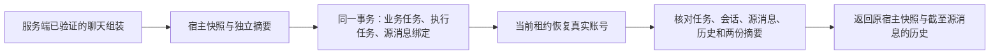

# T-915：聊天宿主快照持久化与租约读取

聊天提交的服务端 assemble 现在可返回 hostContext。提交器先将它从 Worker 输入中拆出，验证后在同一事务内把快照保存到 execution.payload、摘要保存到 aiTask.inputData。旧任务没有快照时继续原重放行为；两侧只有一项、格式错误或摘要变化均拒绝，不能退化成旧任务兼容。

快照使用版本 1 的严格结构，包含 ChatContext、mediaRoute、positioningScratch、trustedScriptSources 和既有 workerSkillSnapshotSchema。保留选区、原文、别名、已解析媒体路由和 Skill 内容，不在恢复时重算。独立 4,000,000 字符上限，ref/Skill ID 不重复，snapshot user/account 与任务一致，ChatContext project 与会话一致，并包含 surface 对应 Skill。结构校验不代替正式组装器的附件/选区/实体归属检查。

surface 到 Skill 的既有纯映射单独提到 chat-surface.ts，chat-context.ts 保留原导出；持久层不因此加载模型 SDK。当前未知 surface 的既有回落行为不变。

createChatHostContextReader 使用 admission 租约，核对 execution→AI→conversation→source 双向关联、业务状态 queued/running、modelInput digest、history digest 与 ID 列表、hostContext digest 和快照归属。返回绑定的源消息及截至该消息的历史，后来的消息不会替代原 latestUserInstruction。旧 fence 拒绝；旧任务缺快照时明确拒绝宿主恢复，不使用当前配置补造。宿主快照没有进入 Worker modelInput；既有 Worker readTaskContext 仍只解析 payload.modelInput。

当场测试证据：初次新增持久化测试 2 fail / 10 pass；加入读取测试后 3 fail / 10 pass。实现后通过，再补单边丢失、跨项目、无关 Skill、重复 ref、容量越界等反例。独立复核和新反例发现业务任务已失败时 reader 仍返回上下文，真实 DB 红测 1 fail / 18 pass 后补 queued/running 状态门。最终提交/读取 19、原上下文 27、聊天 runner 142，共 188 项通过；前后端类型检查通过。

独立设计评审与代码复核均完成，最终未发现本批具体阻断；评审者未独立重跑测试。边界原有 5 条无新增，orphan 0 errors / 100 warnings，任务范围门通过。CodeGraph 刷新后结合 rg/类型检查核对纯函数消费者。

本轮还修正上批自身证据登记遗漏：chat-read-host.md 描述既有通信的术语触发复杂度门，给该已提交证据文件登记精确哈希和已授权类别；没有增加通信机制，也没有把上批缺少前置红测改成 PASS。

本批只证明快照提交与读取服务，尚未把正式 prepareChatTurn/route 的可信输入与 Skill snapshot 装配到 hostContext，也未接生产 resolver 或动态任务工具宿主。选择与来源继续由既有真实服务校验，完整 T-915 范围未缩减。测试为隔离 PGlite 与 fixtures，无商业模型、用户库、安装、推送或部署。

本轮 pmem sync 完成；全局 reconcile 实测仍为 211 errors / 1 warning，未通过，继续保留 T-916 工程对账债务，不据本批局部验证完成 T-915。
