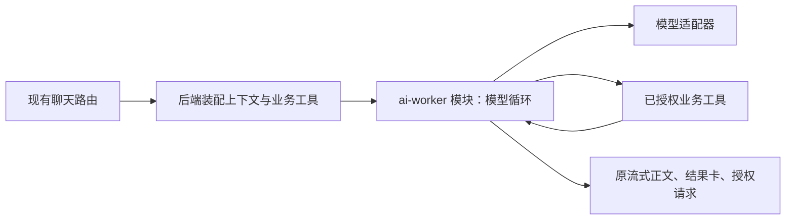

# T-915 聊天模型循环职责迁移

2026-09-05。R-05 / AC-08 仍在实现中，不是整体验收。

原 chat-runner 同时负责业务上下文、工具装配、模型循环和运行回调。现把模型循环及其协议策略移至 ai-worker，现有 runChatStream 已实际调用新入口。后端继续拥有业务上下文、当前权限、工具闭包、模型配置及消息落库。

图中的 ai-worker 是代码模块归属；本批尚未把聊天回合搬入独立 Worker 进程，HTTP 断开语义仍待迁移。

## 当前改动

- ai-worker/runtime/chat 是模型循环唯一实现，集中步骤收尾、显式工具顺序、同轮同参去重、工具名及 system 引用编码、script.patch 参数协议修复。原业务工具名和卡片输出不变，授权映射使用同一个名称编码。
- backend/chat-runner 删除原循环策略实现，调用 createChatModelStream，并继续提供用量、完成、错误回调。模型重试仍由原恢复包装器承担，SDK 重试保持 0；本批不改变重试政策。
- backend/chat-tool-gate 的名称编码改为引用同一 Worker 实现，权限判定与错误信封继续在原 owner。保留该模块对现有消费者的编码出口；原 chat-runner 的纯策略测试改为直接读取 Worker 出口，无第二份实现。
- 修复上轮证据文档触发的复杂度登记缺项：按 DEC-RUNTIME-055 与准确文件哈希登记，不删除技术描述来绕过门卫。

## 本批证据

- Backend 聊天装配和工具门 **164 PASS**。其中新增实际 runChatStream → createChatModelStream → SDK → 本地 SSE 供应商验证：完整正文、完成回调和累计真实用量一致，HTTP 请求 1 次。其余测试保留既有业务 fixtures。
- Worker 模型循环 **5 PASS**：普通文本一次模型；工具来源正文进入下一步模型请求且 UI 流保留结果卡；授权允许/拒绝分别续接；持久模型保存确认失败不执行工具、不请求下一步。
- Frontend 聊天路由 **51 PASS**。该组 mock 掉 runChatStream，证明路由装配兼容，不代表 UI 或独立 Worker 验收。
- 合计 **220 项不同测试**。本地 SSE 和模型流 fixture 不代表真实商业供应商。Backend/Worker/Contract/Frontend 类型检查通过；boundary 5 条基线、0 新增；orphan 0 errors / 100 warnings；scope 空错误列表。全局 reconcile 实测仍为 211 errors / 1 warning，未全绿。

## 缺口与后续接线

本轮为保行为抽取，不伪造 TDD 红测。首次类型检查失败，因为 SDK 通用参数包含互斥 prompt/messages 和函数型授权，抽取入口现显式限制为现有聊天实际使用的 messages 与按工具授权映射，再次检查通过。

此处的同轮内存去重不是跨重启副作用账本；通用错误信封不能未经明确分类就当作可重试错误。下一步需要冻结经服务端验证的聊天输入与工具定义，保留真实来源和选区锚点，以持久模型回执绑定工具调用，替换业务闭包的跨进程执行方式；授权续接、消息提交和订阅必须跟同一执行任务绑定。不能先移除 req.signal，而让任务仍没有独立 owner。

尚无新的独立评审回执。完整 T-915 的聊天迁移、其他 AI 入口、生产浏览器资源清理、性能样本和双平台安装包验收仍待完成。当前没有发布或安装。
