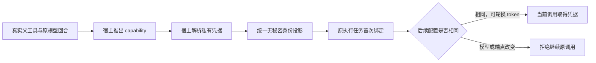

# T-915：聊天子模型专属身份绑定

生成节点的模型身份以真实父工具调用为键保存在原执行任务中。开场真实准备链路已接入：仍沿用原主聊天模型，并将该身份绑定到具体父调用。结构化节点登记 topic.enrich 和 positioning.generate，分别使用各自 capability；不能借用主聊天模型。

- 新服务核对原任务、父工具、冻结工具声明、参数摘要、副作用和当前模型回合；不能引用其他任务的父调用。capability 不接受 Worker 自报。
- 根模型与子模型共用无秘密身份投影。保存能力、模型、协议、端点摘要等；token 和原端点不进入该身份快照。同一配置密钥轮换允许继续，模型、端点、认证方式或结构化配置改变则拒绝。
- hooks 的 pinPrimary 只读取已固定主模型。结构化节点无法通过该方法借用主模型；专属 pin 只能由可信宿主 resolver 提供配置，尚未开放给 Worker。
- 私有工具声明新增 worker.structured-node，仅允许上述两项 proposal 工具；宿主移除该模式的 execute。调度器检查 Worker 的真实 chat.structured 能力，未具备时提前拒绝，不回退宿主执行模型。

独立只读复核未发现具体阻断，评审者未运行测试。专属身份服务测试使用真实数据库；首次测试夹具误用了公开任务 DTO 与不合法摘要，修正为真实任务行和合法摘要后再验证，这些夹具失败不冒充产品红测。

此批没有开放完整结构化生成通路；首次节点 facets/Skill 快照、共享 reserve/start/settle/complete/fail/restore 端口、Worker 执行及候选投影仍待连接。完整聊天仍有前序确认的 13 项未接工具，T-915 继续进行中。

本轮验证：子模型、原主模型及 hooks 服务三个文件 71 项通过；调度器 10 项通过；真实独立 Worker 14 项通过（含读取实际能力后拒绝未支持结构化节点，凭据调用/宿主替身/模型账本均为 0），共 95 项。backend 类型检查与精确写集预检通过。boundary 为既有 5 项，orphan 为 0 errors / 100 warnings。本地测试模型不替代商业供应商与双平台验收。

最终对账：pmem sync 已执行；reconcile 为既有 211 errors / 1 warning，仍未通过。未将全局欠债或未迁移能力记作完成。
