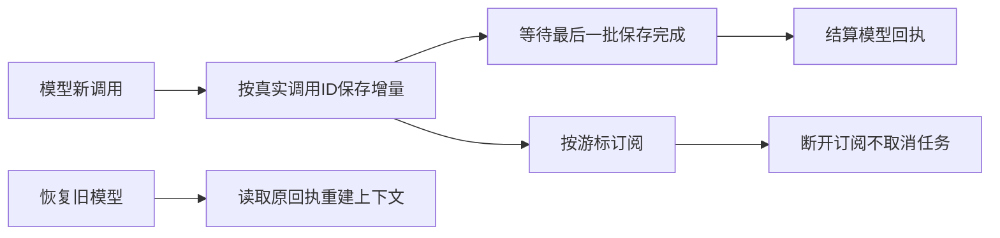

# T-915：聊天模型增量进入持久事件流

真实正式 Worker 测试证明：聊天原来虽能保存最终回复，执行中的文字没有进入事件表。本批在模型适配器持有真实调用 ID 的位置接入已有事件写入器；新调用的文本、推理、来源、文件先保存，再完成模型结算。已确认模型回放不创建写入器，避免按不同时间合批重复追加。

真实红测：正式 Worker 回复成功但读取持久文字为空。修复后正式 Worker 14 项和事件服务 6 项通过；Worker 持久流/转换/批量写入 16 项通过，去重共 36 项。live 用例故意保持供应商流未结束，确认正文已经可读；关闭订阅后执行仍 running，再继续同一次 HTTP 请求至成功。恢复用例确认没有重复增量。写入确认丢失用例确认模型不提前 settled，供应商只调用一次。

文本与推理片段 ID 加真实调用前缀，避免不同模型回合复用供应商 ID。来源与文件保持现有 UIMessage 形状。转换器不把工具声明、授权或 finish 写成执行事实；这些仍由后端账本投影接线承接。

worker_review 独立只读复核本批未发现具体阻断。测试使用本地 SSE、实际构建的 Worker 子进程、隔离 PGlite；商业供应商、公开聊天订阅、工具卡片与完整页面仍未验收。T-915 保持进行中。

最终全局 reconcile：211 errors / 1 warning，exit 1，与上批一致。边界无新增违规，原 5 条保留；orphan 0 errors / 100 warnings。既有工程欠债仍由 T-916 跟踪。
