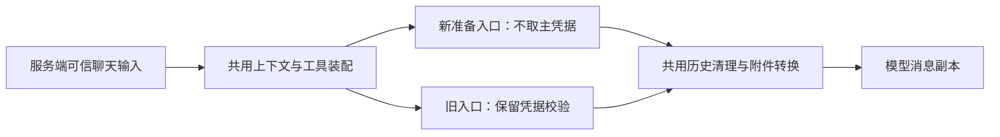

# T-915：聊天准备与主模型凭据分离

新增 prepareChatAssembly 与 prepareChatTurn，准备上下文、真实工具和模型消息时不取主模型凭据。旧 buildChatAssembly 仍在原装配位置读取凭据并创建主模型；两条入口共用私有装配逻辑，避免维护第二套白名单和提示词。

chat-model-messages 提取原来的废弃授权清理、不可用 script.patch 清理、历史窗口和 SDK 附件转换；runChatStream 已调用同一 helper，存储消息保持原样。新 prepareChatTurn 复用媒体路由、scratch 判断、可信原文及最后用户指令提取。

旧工具暂仍包含模型执行闭包。它们在新准备路径执行时才解析主模型，并发共用一次解析；旧入口复用既有句柄。独立审查发现首次失败会缓存 rejected Promise，新增红测实际复现只有一次 resolver 调用，随后修复为失败时只清除自身缓存。配置恢复后同一工具再次取得凭据并产生非空 fixture 候选。

验证：backend 聊天装配与历史窗口 160 项通过，frontend 原聊天路由 51 项通过；合计 211。backend/frontend 类型检查通过。首个红测实证原准备会读取一次凭据；第二个红测实证失败缓存不能恢复。图片附件按当前已安装 SDK 的 file/data-url 结构验证，没有为了测试改换附件协议。除已有本地 SSE 测试外，工具模型使用 fixture，不是商用模型验收。

runtime_code_review 独立只读复核通过。边界原有 5 条无新增，orphan 0 errors / 100 warnings，范围门通过。公共路由尚未改用 Worker；真实工具版本/副作用/参数验证、持久可信上下文、Skill 快照和剩余模型工具迁移仍在原 T-915 范围，不能把本批称为整个聊天执行迁移完成。

## 下一接线点的本地依赖核对

runtime_code_review 只读检查当前工具定义和已安装 Zod 4.4.3：实际 JSON Schema 可以由 z.fromJSONSchema 转为 safeParse 校验器，无需新增依赖。provider 仍应接收原 schema，不能反向转换后改变描述与协议。SDK inputSchema.jsonSchema 可能为 Promise，准备时需 await；旧 jsonSchema 包装器缺 validate 时不能作为宿主参数校验依据。

该转换器不能视为支持任意 JSON Schema：uniqueItems、contains、minProperties、patternProperties 等存在忽略或不完整执行，default 会改写输入。下一接线须基于当前工具使用的受测关键字子集明确拒绝未支持约束，并用独立正反样例验证。这里记录只读调研线索，不将子代理临时探针当作已归档的参数契约 Gate PASS。

最终全局 reconcile：211 errors / 1 warning，exit 1，与前批一致。既有欠债由 T-916 跟踪，未记全绿。
