# T-915：移除聊天只读与候选工具的隐藏写入

独立只读复核推翻了上一批盘点的两项判断：context.positioning.detail 原先经 getPositioningCenter 清理历史 statusNote（CAS 写入）；video.edit.render 原先经 getProduction 在缺制作记录时建行，之后才可能因无分镜失败。必须先消除这些副作用，才能分别声明 none 与 proposal。local.read 成功消费一次授权，仍应保守按 committed 接线。

```mermaid
flowchart LR
 A[聊天与生成上下文] --> B[定位只读投影]
 B --> C[只屏蔽返回值中的旧错误计数]
 D[剪辑候选准备] --> E[校验输出归属并查询已有制作]
 E --> F[有方案：返回候选，原记录不变]
 E --> G[无记录：明确说明，不创建]
 H[原页面初始化] --> I[保留建制作记录行为]
 J[原定位页面或显式清理] --> K[保留历史清理行为]
```

新增 positioningService.readPositioningCenter，复用原完整中心投影与账号隔离。已有窄范围错误计数判断只修改返回 DTO；旧 getPositioningCenter 仍先调用原清理服务。persistence-client 内所有定位读取（包括 CreativeContext、生成和每日选题上下文）接只读端口，避免准备过程隐式写入。没有新增语义选择算法。

productionRepository.findProductionByOutput 先验证真实 output 的用户与账号归属，再返回记录或 null；旧 getProductionByOutput 保持缺行异常。productionService.readProduction 暴露该只读服务。prepareVideoEdit 使用它，缺记录返回既有人话错误，有记录继续原有候选处理。旧 outputs.production.get 仍初始化记录，既有页面行为不变。

当场红测：新增 3 项失败、原 39 项通过。实现后 42 项服务测试全部通过，覆盖无写入、旧初始化与清理兼容、账号隔离、缺输出和现有记录回读。真实 runtime 集成测试 1 项通过：隔离 PGlite 中实际装配定位与剪辑端口，核对原定位记录未变、无 production 时不建行、有分镜时生成移除信息卡候选且原制作记录完全相等、跨账号拒绝。生产公共 transport 回归实际执行 1 文件 3 项通过；命令中的 positioning.persistence-client.test.ts 不存在，没有计作已验证。

backend 类型检查通过；frontend 首次因测试中可空 renderProps 缺非空断言失败，补断言后重跑。边界剩余 5 条，无新增；orphan 0 errors / 100 warnings。独立只读评审未发现具体阻断，评审者未独立重跑测试。CodeGraph 已刷新，动态 service 装配仍以 rg 与 TypeScript 核对，不能把图中缺调用者当死代码证明。

范围门首次因 persistence-client 修改使既有复杂度哈希失效而阻断；复核本批未新增凭据、原生工具链或运行时机制后，仅将 T-915 的既有复杂度登记绑定当前文件哈希，复跑通过。未扩大登记类别，不代表完整任务通过。

本批是消除真实副作用，不是完整聊天 Worker 切换。工具声明、真实宿主适配、持久可信上下文、公开入口以及 SPEC 全部验收继续推进；T-915 不完成。所有数据仅来自隔离测试，没有使用用户库、商业模型、安装、推送或部署。

最终 frontend 类型检查通过；全局 reconcile 为 211 errors / 1 warning，与上一批一致，既有欠债保留，不调用 taskctl complete。
