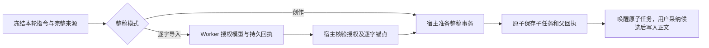

# T-915：聊天整稿接入 Worker 授权与原子提交

`script.draft` 已加入持久聊天工具装配器：普通创作直接提交已有整稿子任务，不新增授权模型；逐字导入在 Worker 使用原主模型执行一次语义授权，宿主从已结算回执解析结果，用冻结来源恢复精确正文，再把整稿子任务与父工具成功回执放进同一个事务。模型建议或 Worker 自报正文、授权布尔值不能成为提交依据。

开场和导入授权共用单次文本模型账本及 Worker 执行器；保留旧开场提示词、节点版本和操作键，不复制第二套重试实现。新增精确的 `worker.script-draft` 声明与受控 IPC；普通工具执行端口不能绕过授权。恢复集合显式接纳这一种可原子提交的整稿工具，不泛化其他有副作用的工具。未知授权不重发；已确认回执恢复不重付模型；限流使用原任务预算和持久重试。

## 真实验证

- 真实 fork Worker：8 项通过。覆盖普通生成、逐字导入、未授权、429 后原任务重试、授权结算后杀 Worker、未知子调用、子结算回执丢失、提交后杀 Worker。包含真实 Host 工具工厂、内存数据库、真实整稿目标服务与子任务事务；供应商仅为 localhost fixture，未调用付费服务。
- 宿主数据库：11 项通过。覆盖零子模型、授权精确正文、未授权/伪锚点零子任务、普通端口不可绕过、未知调用不重发、跨租约恢复、取消与提交中事实变化。
- 原开场实际 Worker：14 项通过；共享节点和混合恢复等：66 项通过；相邻装配与聊天入口：51 项通过；原子提交：42 项通过。各组日志在本目录，不能将这些局部测试替代完整产品验收。
- backend、ai-worker TypeScript 检查退出码 0；frontend `tsc --noEmit` 退出码 0（不是前端构建或完整 `next typegen` 验收）。
- 独立只读审查未发现其余具体阻断。
- `pmem sync` 已执行；全局 `reconcile` 退出码 1，仍为既有 211 errors / 1 warning。见 `chat-script-worker-reconcile.log`；不将其记为全绿。

测试真实复现了一个取消缺陷：子任务事务写入返回时中止，原先仍返回已提交成功。`chat-script-draft-commit-abort-red.log` 是断言级失败证据。已在子任务提交返回后和父回执更新后补中止检查，原失败测试现通过，整笔事务回滚。初始缺模块、测试夹具遗漏项目归属端口、测试时间推进越过总预算等失败没有计为生产问题或 TDD 红测。

所有数据库和项目均为本测试创建；未访问真实媒体目录、迁移 API 或已安装客户端。Git hook 环境缺少 lefthook，未宣称 hook 执行。

## 尚未完成

正式 `/api/chat` 仍走旧入口。该工具迁移与实际 Worker 验证完成，不代表全产品入口切换完成；`topic.generate`、发布/转写/截图/分享/封面/复盘/知识提炼工具及 R-05 入口统一、旧路径退役、性能和双平台验收仍需继续。T-915 保持进行中。
