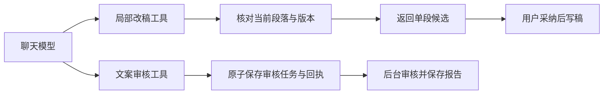

# T-915 局部改稿与文案审核接入持久聊天

2026-09-06。沿用 T-915 已评审 SPEC 与 DEC-RUNTIME-055，仍处于 BUILD，完整范围没有缩减。

## 本批结果

局部改稿复用原工具的两套参数和结果卡：明确选中段时，模型只提供新正文；自然语言改段时，模型选择当前稿真实返回的 sectionRef。新调用执行前校验当前原文、版本、段落与归属，不写入稿件、不追加模型调用。用户采纳继续经原有版本校验路径。

文案审核改为原子提交真实 script.review 子任务，子任务与父工具成功回执在同一事务保存，卡片仍为 review.report。复用现有可审整稿判断、原稿版本绑定、语义审核 Worker 与报告保存；报告完成不自动应用改写。准备失败由已有持久补偿继续处理，无须重启；空稿保留原错误卡，不创建任务和模型调用。

## 关键恢复边界

独立审查发现：不能在工具工厂创建时读取当前稿并拒绝旧版本，否则补丁已结算后用户编辑稿件，会阻断 Worker 重启回放。已用真实红测记录，再把校验移动到新调用实际执行时。已结算调用回放原结果，不再次读取或修改稿件。

真实进程测试覆盖“宿主补丁已结算→杀死 Worker→用户读源更新到新版本→过期租约恢复→原回执完成”，当前稿读取仅一次。该测试的稿件读源为受控服务替身，不冒充真机界面编辑验收。

任务类型与卡片类型采用固定协议映射：review.script → script.review / review.report。准备补偿仍验证真实父工具、账号、原 attempt 与成功回执，不能仅凭任务行或自报 taskId 唤醒审核。

## 证据

- chat-script-patch-red.log：宿主工具尚未接通的真实红测。
- chat-script-patch-replay-red.log：版本变化阻断工厂重建的真实红测。
- chat-script-patch-worker.log：11 项宿主测试和 4 项真实 fork 测试通过；包括正常、无修改、成功回执丢失、结算后改稿与重启。
- chat-review-red.log：原子审核工具尚未接通的真实红测。
- chat-patch-review-green.log：67 项宿主与原子事务测试通过。
- chat-patch-review-regression.log：412 项通过。旧聊天和原工具的完整专项回归，另覆盖审核任务真实回执与重复提交。
- chat-review-production.log：8 项生产装配集成通过；包含论点、素材及审核首次准备成功/瞬断恢复，以及空稿零子任务。使用临时数据库、真实 Worker 与本地模型服务，模型输出为测试数据。
- chat-patch-review-backend-types.log、chat-patch-review-frontend-types.log：类型检查。
- chat-patch-review-reconcile.log：完整工程对账仍为 211 错误 / 1 警告，与前次基线一致；历史欠债由 T-916 跟踪，本次不写成全绿。

测试继续阻断存储迁移 API，仅初始化隔离测试数据库和临时媒体根，未操作真实媒体目录。

正式 /api/chat 全场景切换、剩余 R-05 入口、旧实现退役、性能基准及双平台验收仍待完成。本批证据不代表 T-915 整体验收通过。
