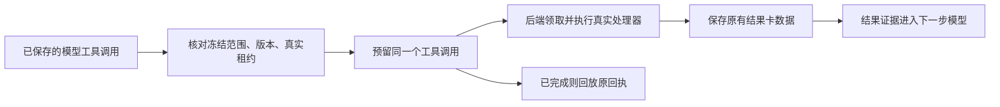

# T-915 聊天工具复用持久调用账本

2026-09-05，承接 R-05。完整聊天迁移仍在实现中。

聊天不另建一套工具账本。后端从已确认的模型回执找出工具名与参数，以冻结工具版本定位当前业务处理器；模型收到编码名，处理器用业务原名，持久回执保留模型关联名。

## 本批实现

新增私有 chatWorkerInputSchema，冻结账号/会话/消息引用、经投影的消息、system、输出预算、步骤上限和工具定义。拒绝名称编码冲突、越界强制工具、函数及非持久字段。工具名称编码提至 contract，Worker 和后端共用同一规则，不通过工具名称猜意图。

既有模型调用端口接受聊天冻结输入，校验任务归属、操作键、冻结输出预算并沿用原调用摘要和账本。既有 Agent 工具绑定器同时接受聊天输入，模型编码名仅用于反查冻结白名单；实际处理器用原始业务名，输入仍从已结算模型回执读取，不使用 Worker 自报参数。工具预留、执行领取、保存、重放及检查点共用已有实现。

此 schema 目前**未加入 Worker 启动输入 union**，正式聊天路由尚未提交 chat.run。没有在尚缺消息提交与授权续接端口时先宣称进程已接管。新增输入的会话/消息字段在本批仅为冻结引用，实际领域实体核验仍须由后续聊天提交服务实现。

## 验证与证据边界

- Backend **36 PASS**：聊天工具端到端账本测试、旧 Agent 工具预留/执行、检查点与流式模型账本回归。
- 新聊天集成使用真实 SDK、模型循环、隔离 PGlite 和本地 SSE；模型调用工具后，真实工具正文/来源进入下一次请求。重建包装器再跑完整模型循环后，HTTP 仍是 2 次，业务处理器仍执行 1 次；账本为 model/tool/model 三条 settled，模型用量合计 10 tokens。检查点回读 ready。
- 同一集成还验证工具版本变化、错误 fence、跨账号冻结输入均被拒绝。数据库中建立真实 ai_tasks → execution_tasks 映射，但会话/源消息使用隔离引用；不是公开聊天路由的完整事务验收。
- Worker **32 PASS**；新私有契约 **3 PASS**。合计 **71 项不同测试**，不叠加重跑次数。类型、scope、boundary 和 orphan 原始日志保留。全局 reconcile 实测仍为 211 errors / 1 warning，未全绿。

## 失败与未完成

第一轮集成 fixture 缺少真实业务任务映射，执行端口正确拒绝；SDK 将工具错误送入下一步模型，测试在 HTTP 回调断言中抛错导致超时。改为主测试断言后定位到缺映射，补齐隔离 ai_tasks 记录后通过。随后核对发现模型名与业务名不同会破坏检查点对应关系，现回执使用模型关联名、处理器单独按业务名定位，并有检查点回读验证。首次契约测试放错目录未执行，移至项目已配置 tests 目录后 3 项通过。无伪造行为红测。

本批未取得新的独立评审回执。仍需正式聊天任务提交服务校验真实会话/消息/来源/选区，冻结完整授权状态，接入 Worker 回合执行和消息完成事务；运行时必须将工具提交未知与可恢复工具错误分开，不能把未知提交当作普通错误让模型继续写入。非文字模型内容的完整检查点兼容也需补齐。完整 T-915 的其余入口、性能、浏览器资源和双平台验收未完成。未发布、未安装、未访问商业模型。
