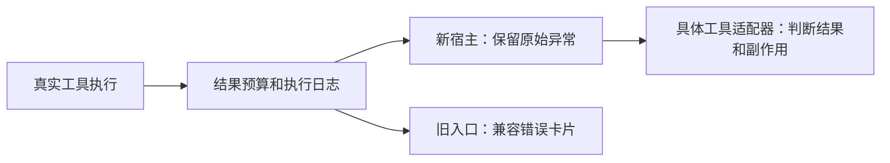

# T-915：保留真实工具异常的执行入口

本批从 defineChatTool 提取共用执行函数，通过工具实例的 WeakMap 提供宿主入口。原始 Error 或非 Error 异常原样抛出，不自行授权、重试或判定副作用。成功返回仍使用原有结果预算与审计日志。旧 SDK execute 调用同一执行函数后将异常转换为原有错误卡片，保持页面协议。

当场先运行新增测试，4 项因缺少入口失败；实现后原测试与工具回归共 241 项通过。backend 类型检查通过；边界仍为原有 5 条，无新增；orphan 为 0 errors / 100 warnings。runtime_code_review 独立只读复核未发现具体阻断，未独立重跑测试。

测试覆盖错误身份、执行次数、humanize 隔离、参数与上下文透传、预算与真实 ID 保留、非 Error 异常、未登记工具拒绝隐式回退。工具自行返回的业务错误信封不会被这里擅自分类，后续具体适配器必须解释。原授权注册未改变，新入口只能在宿主完成参数、归属、授权和执行权检查后调用。

该入口尚未接入公开聊天，不代表实际工具迁移或可靠重试已经完成。version/effect、真实服务适配、持久可信上下文与 Skill、公开路径和全范围验收继续属于 T-915；任务保持进行中。本批没有调用商业模型、安装、推送或修改用户数据。

本批 task-preflight 范围检查通过。另行运行未限定范围的 governance 审计报告 314 项阻断，包含现有桌面构建产物和旧文件；原始结果保留，不声明该全库审计通过。

最终 reconcile 为 211 errors / 1 warning，与上一批一致，T-916 既有欠债保留。T-915 未完成，不调用 taskctl complete。
