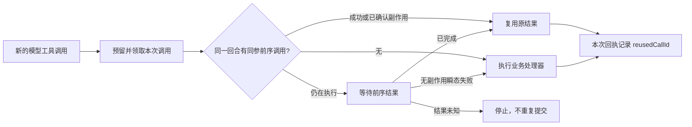

# T-915 聊天同参工具复用与完整账本

2026-09-05。承接 R-05，完整迁移仍在实现中。

此前聊天的内存去重直接返回旧结果，导致新的模型工具调用没有工具账本记录。真实回合测试在后续检查点保存处失败。本批把持久聊天的同参复用放到后端，每次模型调用保留独立逻辑记录，并引用已确认结果。

## 已实现

持久聊天关闭 SDK 外层内存去重，由既有后端工具执行端口处理。普通旧聊天默认内存去重保持；Pi 工具每次动作仍按其独立调用执行，没有套用聊天同参复用。

后端只在同一真实执行内比较冻结工具身份、规范参数和 effect，不按文字相似度判断含义。后续调用等待最近的同参前序调用，形成按账本次序的串行关系。前序成功或已确认 proposal/committed 副作用时复用；明确无副作用错误允许后一次实际执行；未知提交阻止后续重执行。

后端生成 reusedCallId，写入当前调用回执；Worker 结算输入不接受该字段，不能自选复用来源。重复确认已保存回执保留原引用。新增可选字段兼容旧回执，检查点仍逐条验证模型/工具关联。

工具回执先按已有严格 schema 校验，再规范成 JSON 传输形式，避免合法可选 undefined 字段导致保存失败。没有放宽未知字段或允许函数进入协议。

## 真实验证

- 先增加完整回合重复调用测试，实测失败于 CHAT_CHECKPOINT_RECEIPT_UNKNOWN；实现后同一测试通过，保留红/绿日志。
- 后端共 **47 PASS**：完整回合 8 种场景、同参宿主并发/瞬态失败/未知/取消/参数差异/候选副作用、旧工具端口与检查点回归。
- 重复调用完整循环回放后：3 次模型 HTTP、1 次实际业务处理器、5 条 settled 逻辑调用、15 tokens，第二条工具回执引用第一条，检查点 ready。
- 并发前序瞬态失败时第二次真实执行成功，第三次复用第二次结果，共执行 2 次；前序未知时后续不执行；取消等待者不修改仍在完成的前序回执。
- Worker **32 PASS**；契约 **4 PASS**，含 Worker 不能自报 reusedCallId 的拒绝断言。合计 **83 项不同测试**，不累计重复运行。
- 同参宿主测试首次 1 项失败：可选 data 为 undefined 导致 JSON 回执校验失败；按严格校验后的传输形式规范化后通过。类型、scope、boundary、orphan、全局 reconcile 日志见相邻 JSON。

## 限制

授权/工具处理器和供应商为隔离 fixtures；数据库与 SDK 为真实实现。当前不是正式 Worker 子进程或安装包验收。chat.run 尚未进入官方启动入口和 `/api/chat`，消息完成事务、持久 UI 流、正式授权续接、非文字检查点和补丁参数修复关联仍待完成。

本批无新的独立评审回执。完整 T-915 其余 AI 入口、性能样本、生产浏览器资源和双平台验收仍未完成；未发布、未安装。

全局对账实测仍为 **211 errors / 1 warning**，保留失败日志；不宣称全绿或 T-915 完成。boundary 为 5 条既有违规、0 新增；orphan 为 0 errors / 100 warnings；scope 无新增项；Contract、Worker、Backend 与 frontend 类型检查均通过。
