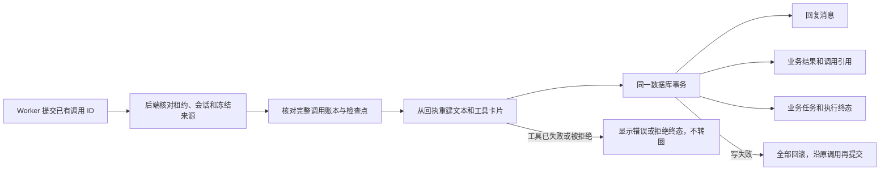

# T-915 聊天回复完成事务与错误终态

2026-09-05，完整 T-915 仍在实现中。

聊天回合已经取得模型和工具的真实回执后，后端现在能把回复文本、工具卡片、业务结果和执行终态一起保存。中途写入失败时整笔回滚；再次提交沿用原调用，只保存一份消息。Worker 只提交调用 ID，不能自报消息、身份、预算或成功状态。

## 实现事实

- 新增私有 `commitChatResult` 命名端口，接入既有宿主分发器；监督器允许结算回读，服务本身仍拒绝取消、暂停、过期租约下的新消息写入。
- 完成事务重读实际 AI/execution 映射、会话 user/account/project、源消息和冻结历史摘要；逐条核对当前已确认调用、工具引用集合、检查点次序和最新模型引用。
- 文本与工具卡片来自持久回执；保存各轮文字，保留工具前的说明和最终回答。来源卡、候选数据只投影，不采纳或修改领域实体。
- 消息、ai_task_results、最终模型 resultRef、ai_tasks 和 execution_tasks 状态一起提交。完成结果或消息被改写时拒绝返回伪幂等成功。截断的可用结果保留为 partial；未知用量为 null。
- 待授权或尚无确认回执的工具不能提前完成。已确认拒绝投影为 output-denied；其 ID 引用拒绝回执，只作终态展示，不代表新的授权。
- 独立评审发现：历史坏 JSON 已结算 invalid_input、模型后来完成时，重新解析旧参数会反杀保存。实测红后修复：仅匹配 error / none / invalid_input 真实回执时保留 rawInput 错误历史，不放行执行。
- 前端原来把 output-error、通用 output-denied 和已拒绝的 approval-responded 显示为持续调用；现显示真实错误或“已拒绝”，无额外按钮或自动重跑。本地读取原有授权卡保持。

## 验证与独立评审

合计 **131 项不同测试通过**：Backend 完成/投影/提交/旧回复/完整 SDK 循环 45，宿主分发与监督器 23，Contract 5，Frontend 完整聊天互动与本地读取卡 58。独立重跑的 2 项投影测试包含在 Backend 45 内，不重复累计。

三个实际红测分别记录：缺少完成端口 1 fail；已纠正坏 JSON 历史投影 1 fail；三种终态 UI 仍出现 spinner 3 fail。保留中途用量字段错误与拒绝卡中间态不匹配的失败日志，不把初次运行写成全绿。

完整循环使用真实 SDK、隔离数据库和本地 SSE 供应商 fixture，覆盖完成、截断、重复工具、拒绝、待授权、空输出、429、未知提交。新增断言验证原始说明文字、最终回答、工具卡、用量、并发消息幂等与两侧任务终态。数据库 trigger 注入终态写失败，证明消息/结果/引用全部回滚后原调用可再次完成。

独立评审已检查事务、租约、归属、摘要、卡片名称与 UI 终态；已发现问题修复后复核无剩余本批确定阻断。独立原始意见和测试日志随相邻 JSON 留存。

类型检查：Contract、ai-worker、Backend、Frontend 通过。boundary 仍为 5 条既有违规、0 新增；orphan 为 0 errors / 100 warnings。IPC 复杂度账本仅按既有 DEC-RUNTIME-055 更新本次监督器精确哈希，scope 复核通过。

## 仍未完成

这不是完整生产聊天迁移或安装包验收：正式 Worker 的 chat.run 输入/启动分发、实际授权续接、持久 UI 事件与 `/api/chat` 订阅切换尚未接通。非文字模型回执、补丁参数修复关联仍需接入检查点和消息投影。现有历史查询仅按 createdAt 排序，同毫秒排序稳定性属于既有待处理风险。

完整 SPEC 中其余模型入口、生产浏览器资源回收、30 样本性能与 macOS/Windows 安装包、真实上游供应商验收仍未完成。没有推送、部署或安装；没有宣称 T-915 完成。

最终全局 reconcile 实测仍为 **211 errors / 1 warning**，exit 1。既有全局欠债继续留给 T-916 跟踪；本批未以此宣称全绿。
