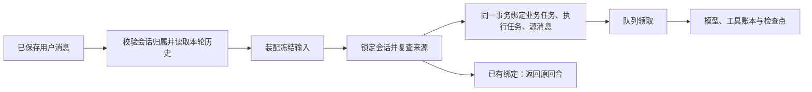

# T-915 真实聊天源消息与持久任务提交

2026-09-05。承接 R-05，完整聊天迁移仍在实现中。

新增后端聊天提交服务，输入只接会话 ID 与已保存的源消息 ID。装配函数从服务提供的真实历史建立 Worker 输入，模型没有直接写库入口。服务在装配后复查来源，并原子保存业务任务、执行任务与源消息关联。

## 实现

createChatTurnSubmissionService 从当前 user/account 验证会话，拒绝跨会话消息与 assistant 源消息；项目会话需配置实际项目归属检查端口。历史截到当前源消息，不混入之后的消息。装配在事务外执行，事务内再次读真实历史并核对摘要；期间内容/范围变化则拒绝旧输入，不把长模型或业务装配放进数据库锁中。

事务内先建 ai_tasks，再经已有 PersistentTaskService 创建 execution_tasks，写回唯一映射并保留源消息已有 metadata。任何一步失败全部回滚，原消息保留。会话锁串行化同源并发提交，赢家落库后其他请求读取同一绑定；重投不再装配或排队。已有旧 replyTaskId 的源消息拒绝创建第二份聊天任务。

重投核对真实任务归属、projectId、历史 ID/摘要、执行 owner 与冻结模型输入摘要。已有 AI 服务的 canonicalJson 抽到同模块共享文件，既有任务指纹与新提交都用同一规则，避免 JSONB 对象键顺序影响身份核对。

## 当前证据

- 提交服务 **9 PASS**：并发幂等、历史范围、metadata 保留、归属错误、装配中内容改变、装配/执行任务创建故障回滚、既有来源变化、冻结输入改写、项目检查缺失/拒绝、旧入口保护。部分单项包含多个断言，不按断言加总。
- 既有 AI service 与旧 copilot 消息事务测试 **57 PASS**，共享 JSON 函数抽取后保持行为。
- 真实聊天工具账本集成 **1 PASS**：现已通过新提交服务从真实会话和源消息建立 AI/执行映射，再走真实 SDK、本地 SSE、真实工具宿主、检查点；重放后仍为两次模型 HTTP、一次业务处理器、三条 settled、10 tokens，检查点 ready。未使用用户数据库或商业模型。
- 合计 **67 项不同测试**，不累计重跑。相关类型、boundary、orphan、scope 与 reconcile 原始日志见相邻证据 JSON。

## 边界与缺失证据

服务导出已完成，正式 `/api/chat` 还没有调用它，Worker 尚未接收 chat.run。当前集成中的装配函数和业务读取 handler 是隔离 fixture，不能宣称真实聊天工具全集和授权恢复都已迁移。提交服务仅创建任务，不负责自行运行或把队列状态标成功。

首次测试在实现后运行，无事前行为红测。集成改线时发生一次括号语法错误，修复后通过；该失败不计为 TDD 行为红测。本批未取得新的独立评审回执。

尚待正式装配适配、源附件与选区验证、授权续接、Worker 执行及完整流式消息完成事务、独立订阅和显式取消 UI；完整 T-915 其余入口、性能样本、浏览器资源和双平台安装包验收仍未完成。全局 reconcile 实测 211 errors / 1 warning；governance 检查已通过，保留其余全局失败。未发布、未安装。
