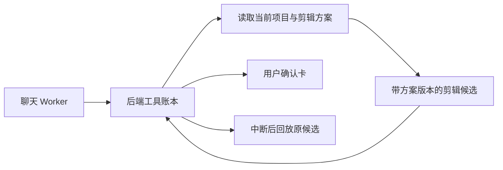

# T-915：剪辑调整候选迁移

本次把 `video.edit.render` 接入统一持久聊天工具宿主。用户仍先看到 `video.edit` 候选卡，确认后才由原采纳链保存方案并渲染。本次没有切换正式 `/api/chat`，也没有完成 T-915 全部验收。

## 实现与边界

- `chat-video-edit-tool-host.ts` 只从原任务恢复真实账号与项目，复用原参数、权限和卡片定义。模型不能传项目 ID 改绑；执行时通过原领域端口重读当前方案和素材归属。
- `video-edit-candidate.ts` 承接原 `persistence-client.ts` 约百行候选准备代码，旧生产入口复用它。仅 `readProduction`，不新建制作记录、不修改方案、不启动渲染。
- 共享短工具适配器按已有卡片登记表验证结果种类，支持工具名与卡片名不同；返回前再查取消状态。未完成读取与错误卡不算成功候选。
- 工具工厂仅恢复冻结定义，领域读取留在实际执行；已结算回执丢失或 Worker 中断后回放原版本候选，不因当前方案后来变化重新生成。

## 当场验证

| 验证 | 结果 |
|---|---|
| 接线前红测 | 新增宿主 8 条用例全部失败：组合工厂尚无剪辑工具 |
| 宿主与相邻工具回归 | 7 文件 52 测试通过，包含下面 4 条真实 Worker 用例，不重复相加 |
| 真实 fork Worker | 正常候选、缺方案错误卡、回执丢失、结算后杀 Worker 并在方案变化后恢复；4 条通过 |
| 实际生产装配 | 1 条通过：实际后端数据库与服务，确认候选版本/内容，数据不变、无子 AI 任务、跨账号拒绝 |
| backend / frontend 类型检查 | 均通过 |
| 独立只读审查 | 未发现阻断；审查者未运行测试 |
| 全局 reconcile | 211 errors / 1 warning，仍未通过；数量与前次相同，T-916 继续保留历史对账欠债 |

Worker 用例使用本机测试模型服务与内存数据库；生产装配使用本次创建的临时数据库目录，并拦截媒体迁移 API。没有调用商业模型、操作真实媒体或启动桌面包。

回归日志：`chat-video-edit-red.log`、`chat-video-edit-worker.log`、`chat-video-edit-production.log`、`chat-video-edit-types.log`、`chat-video-edit-frontend-types.log`。全局对账结果单列在 `chat-video-edit-reconcile.log`，不能用本批通过代替全局或 T-915 全场景通过。

## 后续完整迁移依赖

整稿 `script.draft` 的独立方案审查已确认：逐字导入前的语义授权必须进入 Worker 的模型账本；成功后再原子提交子任务，且 output_script 的复用/创建需与提交同事务。不能直接把旧 dispatch 包成宿主工具，否则保留宿主模型调用、重复建稿风险。此项尚未实现，不记为完成。
