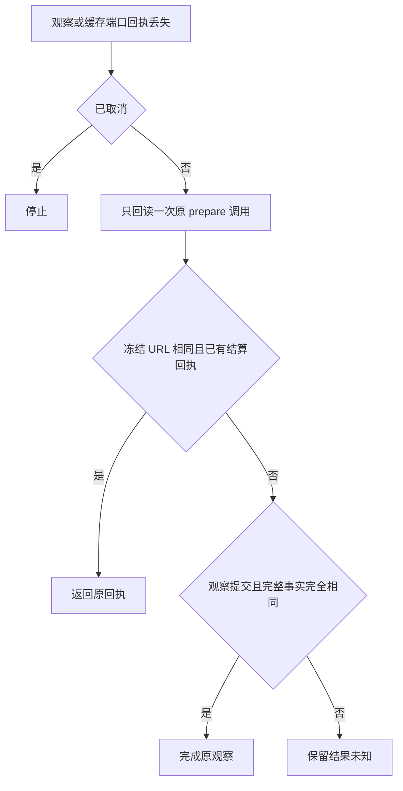

# T-915 网页观察与缓存回执丢失的同调用对账

原网页适配器在观察或缓存响应丢失时直接抛出，外层 durable wrapper 会将尚未结算的父调用标记为 unknown。即使正文事实已保存，也无法在该轮继续完成。现在先在网页适配器内做一次只读对账，再决定是否保留未知。

- 回读固定使用原 callId，并继续受 admission、fence、归属与取消检查约束，不扩大后端端口权限。
- 缓存 ACK 丢失只接受已结算 output；不重新读缓存、不修复新文件、不启动浏览器。
- 观察 ACK 丢失可接受已结算 output；否则必须冻结 URL 相同、evidenceRef 非空、同 schema 全文及全部诊断完全一致才完成原提交。不把另一份观察当成本次成功。
- 回读失败、缺事实、异 URL/观察、缺 evidenceRef 或取消均有界停止；不重新观察、不抓网页，也不产生普通失败卡片。
- 原完成端口仍只有限重发同一结算，通用 unknown 账本规则未放宽。

## 验证

- [当场红测](chat-web-read-ack-reconcile-red.log)：8 项失败、2 项通过、7 项跳过；此前没有观察/缓存 ACK 回读路径。
- [Worker 回归](chat-web-read-ack-reconcile-green.log)：25 项 / 3 文件通过，覆盖成功对账、异事实、回读再次失败和取消，以及原资源与启动恢复行为。
- [后端组合回归](chat-web-read-ack-reconcile-backend.log)：40 项通过，真实隔离 PGlite/LocalFS，包含 observe/cache 实际提交后注入 ACK 异常、唯一素材与证据、取消和换 fence 后不创建素材。
- 两个 ACK 成功用例进一步接入真实 `runDurableAgenticTool` 及后端 reserve/start/settle 端口，2 项通过、38 项跳过，结果见[持久工具组合回归](chat-web-read-ack-reconcile-durable.log)，不是只验证单独适配器。
- 网页读取是明确 fixture，未将本次当作跨进程或真实浏览器 ACK 故障验收。既有真实 Chromium 证据见资源接线记录。
- ai-worker 与 backend 最终类型检查均退出 0；backend 首次发现旧 observation fixture 的字符串推断过宽，保留字面量类型后复核。
- 独立只读审查确认对账在外层标记 unknown 前完成、没有重复动作；取消/fence 仍由真实后端阻止。
- boundary 既有 5 项、无新增；orphan 0 errors / 100 warnings。已执行 pmem sync；[全局对账](chat-web-read-ack-reconcile-global.log) 仍为 211 errors / 1 warning，与前基线一致，未通过。

本次处理的是 Worker 仍存活且宿主回读可用的 ACK 窗口。若回读本身也失联，仍进入未知，不宣称所有 unknown 记录都能自动恢复。正式网页能力声明与全链路验收、后续证据消费、其他 R-05 入口迁移、性能、商业模型与双平台验收仍未完成。
