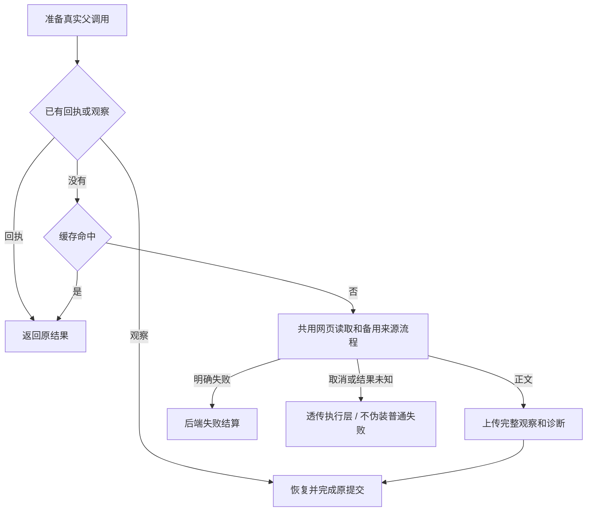

# T-915 Worker 网页执行适配器

新增 `runChatWebReadInWorker`，将后端已具备的网页端口串成可执行流程。浏览器只读取事实，后端仍负责缓存、素材和最终卡片。实际 Worker 启动装配及生产能力声明尚未开启。

- 缓存命中和持久观察恢复不重新读网页。观察保留全文、最终 URL、抽取路径及对话轮数，完成回执丢失只有限重发同一结算请求。
- 从原共享编排抽出 `acquireWebDocument`，旧网页入口继续复用相同登录、HTTP 备用来源顺序和会话提示逻辑；原保存和缓存结果行为保留。
- 备用搜索与会话提示查询增加可选错误透传判定。Worker 保留 `GenerationFailure` 原异常，不将未知宿主回执吞成普通 HTTP 失败，也不继续下一个引擎。旧入口缺省行为不变。
- 浏览器运行时不可用、登录、HTTP 被拒和无效正文分别交给后端明确结算；取消与未知提交不产生伪造成功观察。

## 验证

- [红测记录](chat-web-read-adapter-red.log)：首次新模块缺失导致加载失败、没有运行用例；后续 2 项 HTTP 回退未知回执用例实际失败，修复后通过，未把缺模块算作行为红测。
- [最终回归](chat-web-read-adapter-green.log)：48 项 / 4 文件通过，覆盖适配器、共享编排、备用来源及既有研究浏览器工具。适配器用例的宿主和读取端口是明确替身，不能作为独立进程／外部供应商验收。
- [旧正式入口回归](chat-web-read-adapter-frontend.log)：隔离 PGlite/临时 LocalFS 的原网页装配 3 项回归通过。
- ai-worker/frontend 类型检查通过。独立复核发现并推动修复未知回执被吞问题；空正文用例又实际捕获未生效的分支，改为 safeParse 后全量重跑通过，最终独立核对实际代码。
- 已执行 `pmem sync` 与 `reconcile`；全局仍为 211 errors / 1 warning，与前基线一致，未通过。boundary 为既有 5 项，orphan 为 0 errors / 100 warnings；未把局部验证写成全局通过。

搜索配置与凭据、专属会话资源装配、Worker 启动恢复与能力声明、真实父子进程全链路，以及网页证据到后续工具的消费仍需继续。T-915 全入口迁移、性能、商业供应商和双平台验收范围没有缩减。
