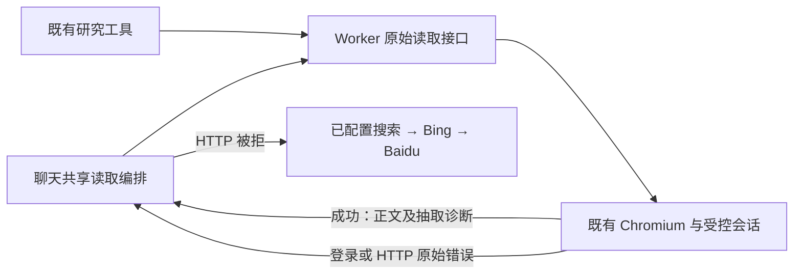

# T-915 Worker 原始网页读取与共享编排

聊天读取需要知道网页是成功、需要登录，还是返回 HTTP 错误，才能决定下一步。现有研究工具会提前把读取失败转换为通用结果，也只上传正文/标题/来源，丢失抽取诊断。本批将其底层读取提取成原始接口，保留事实和错误，由聊天共享编排继续处理。

## 实现

- `createResearchWorkerTools.readDocument` 返回完整 `ReadResult`，保留原始登录及 HTTP 错误类型；宿主明确 blocked 用专门错误携带原结果，不能误当网络瞬态失败。
- 原研究工具继续复用同一读取，不增加另一套浏览器/context。原始读取和搜索、交互操作共享串行队列、URL/重定向守卫、版本化 session 及资源关闭责任。
- 排队前固定 URL 和 scope；取消检查覆盖守卫、session 回执和浏览器完成。排队时取消的读取不创建新 context。原始读取不结算研究工具或创建素材。

## 证据

- [红测](chat-web-read-browser-red.log)：3 失败、10 通过，新原始读取能力不存在；不冒称旧生产路径行为红测。
- [回归](chat-web-read-browser-green.log)：34 项 / 4 文件通过，包括原研究浏览器、原始接口、真实浏览器组合及共享编排回归。
- 真实临时 Chromium 读取本地 HTTP 页面，验证成功全文和 HTTP 403→备用来源分支；备用搜索采用测试替身，明确验证 configured→Bing→Baidu 次序，不冒充商业搜索或公共搜索网站真实验收。
- 还覆盖完整 SSR 诊断、HTTP 异常身份、同域登录墙不重复导航、宿主 blocked、排队取消零新增 context 与排队身份快照。原资源关闭与研究路径测试继续通过。
- [类型检查](chat-web-read-browser-types.log)：contract、ai-worker、backend 均通过；frontend `tsc --noEmit` 完成且退出码为 0。
- `worker_review` 独立只读复核未发现本批兼容、资源或安全阻断。

## 继续接线

本批不是完整聊天网页 Worker 迁移。命名端口、缓存、搜索凭据及浏览器会话装配、pending 正文提交、启动恢复顺序和正式入口切换仍需完成。真实 Worker 进程崩溃恢复、供应商、性能及双平台验收保持原 SPEC 范围。

收尾：`pmem sync` 已执行；全局 `reconcile` 为 **211 errors / 1 warning**，与既有基线数量一致，未写为全绿。边界 **5** 条基线违规、无新增；orphan **0 errors / 100 warnings**。T-915 保持进行中，未发布或操作真实用户数据。
