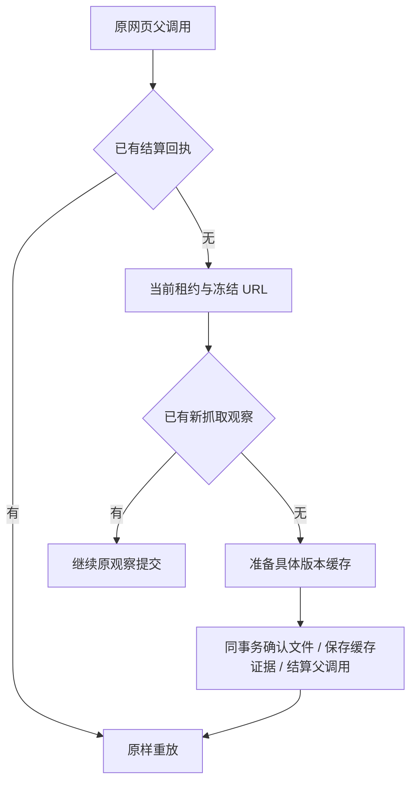

# T-915 网页缓存与父调用原子结算

缓存命中后，文件修复与执行回执不能各自成功。本批将版本确认、缓存证据和父调用回执放入同一事务，并接入 `readChatWebReadCache` 命名端口。

- Worker 只能给出真实 `callId`，不能自报缓存素材或文件。后端按冻结 URL 准备缓存，再在当前租约下确认原文件，校验期间取消会回滚。
- 缓存保存独立 `chat.web.read.cache` 证据，绑定素材、文件、输入摘要、来源及已读正文。原观察存在时不改用另一份缓存；已结算时直接重放，素材后来编辑、删除或任务取消不重建素材。
- 原新抓取与缓存结果共用成功卡片投影，保留正文窗口、不可信内容包装和诊断。缓存明确带 `fromCache` 与 `extractor: cached`，不伪装成刚抓取。
- `prepare` 的已结算分支先返回回执，避免把缓存证据交给只接受新抓取格式的解析器。命名端口允许读取既有回执，新的缓存确认仍经过 admission 与宿主 signal。
- Worker 缓存证据沿用单页 2 MiB、任务累计 8 MiB 限制，超限时不修复文件或写成功回执。原网页入口没有因此新增限额；完整迁移仍需验证全部输入族和可用性。

## 验证

- [红测](chat-web-read-cache-red.log)：4 项新增失败、28 项既有通过，失败为方法不存在。
- [回归](chat-web-read-cache-green.log)：59 项 / 4 文件通过，含网页集成、版本化缓存、研究 Worker 与 supervisor。新增 6 项验证原素材复用、父回执写失败的整体回滚、已结算后编辑/取消重放、未命中及已观察分支、单页超限、真实父回执 UPDATE 返回后取消全回滚。
- 缓存命中不读取浏览器会话或新增素材；测试使用隔离 PGlite 和真实本地存储，尚不是完整独立 Worker 网页运行验收。
- contract、ai-worker、backend、frontend 类型检查通过；独立只读复核及增量复核无阻断。
- 补充 `cache hit → prepare` 原回执断言后，定向 1 项通过（其余 33 项未选择）；记录附在回归日志后，不计为全量重跑。
- 收尾运行 `pmem sync` 与 `reconcile`；全局仍为 211 errors / 1 warning，与前基线一致，未通过。boundary 为既有 5 项，orphan 为 0 errors / 100 warnings；没有将历史工程欠债标为通过。

## 仍未完成

缓存与新抓取的聊天证据尚不能直接供现有 research 验证器和知识提案消费；后续必须按证据类型验证真实摘要，不能跳过验证。Worker 网页执行适配器、搜索配置、启动恢复消费和生产入口切换仍待实现。T-915 的全入口迁移、性能、商业供应商及双平台验收范围不变。
