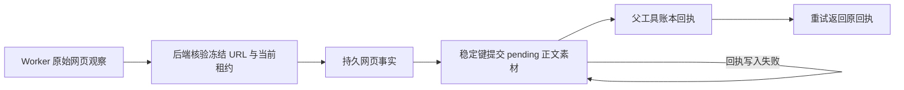

# T-915 网页观察、素材提交与父调用回执

## 本批落点

网页读到后先保存可校验的事实，再由后端素材服务保存待用户确认的正文素材，最后结算工具回执。中间一步失败时沿用原调用身份恢复，避免重复创建素材。新增能力尚未在正式聊天入口启用，不能据此声称 `web.read` Worker 迁移完成。

## 实现与边界

- 原始观察只接受正文、标题、最终 URL 与抽取诊断，不接受 Worker 自报账号或素材 ID。原请求 URL 来自冻结聊天上下文，优先于模型参数；最终 URL 不替代素材原来源。
- 同调用正文和全部诊断参与身份摘要。任务锁内原子校验单页 2 MiB、任务累计 8 MiB 并插入观察；观察本身不创建素材。
- `execution_evidence.metadata` 保存网页专用身份字段，其他现有证据默认为空对象；保持研究工具原有写入授权边界。0086 迁移只在隔离测试数据库验证，没有操作真实用户库。
- 复用 `pendingDocument` 稳定提交键。最终素材事务再次验证租约、父调用和观察身份。保留原 `web.read` 全文窗口、不可信内容包装与诊断映射；只有真实提交完成才提供素材卡。
- 并发完成在同任务锁内返回原账本回执；失去执行权的并发请求也只能重放已持久回执，不重跑工具。素材已删除或当前文件改变时返回明确错误，不恢复或覆盖用户改动。
- Worker 尚不声明 `chat.web-read` 能力；调度器在模型调用前拒绝缺少能力的此类工具，正式定义默认值不变。

## 当场证据

- [初始红测](chat-web-read-commit-red.log)：新服务与宿主模块尚不存在，属于能力缺失，非旧实现行为回归。
- [并发红测](chat-web-read-commit-concurrency-red.log)：5 项通过、1 项失败；同调用的随机内容包装引起第二次结算冲突，已修复。
- [最终集成回归](chat-web-read-commit-green.log)：14 项 / 2 文件通过，其中新增网页提交 9 项、已有聊天研究 Worker 5 项。隔离 PGlite、真实本地文件存储和原素材领域服务；包含数据库触发器故障注入，不使用真实外网或商业模型。
- 覆盖冻结 URL、观察不写素材、全文与原窗口、同键重复及并发完成、诊断冲突、非法正文/URL、跨任务、取消、回执失败恢复不重写字节、观察篡改与素材删除不复活，以及五个 2 MiB 网页并发提交只能保存四个的任务预算检查。
- [类型检查](chat-web-read-commit-types.log)：contract、ai-worker、backend 全通过；frontend 的 `tsc --noEmit` 也完成且退出码为 0。
- `worker_review` 独立只读审查未发现本批阻断。已明确旧 attempt 观察可回读不等于可恢复完成、HTTP(S) 校验不代替 Worker 网络守卫、尚缺真实进程中间崩溃恢复验证。
- 新 attempt 完整恢复仍需在后续真实 Worker 接线测试中验证，不能把代码检查写成运行 PASS。

## 尚未完成

命名 IPC 端口、真实浏览器与会话接线、登录和失败/备用来源结果、缓存路径、检查点恢复和正式入口切换尚未完成。本批不减少 R-05 未完成生产入口数量。T-915 保持进行中；性能基线、商业供应商和双平台验收仍按原 SPEC 执行。

本轮收尾：`pmem sync` 已执行；全局 `reconcile` 为 **211 errors / 1 warning**，与既有基线数量一致，未写为全绿。边界扫描剩余 **5** 条基线违规、无新增；orphan 为 **0 errors / 100 warnings**。未调用 T-915 complete。原始并发红测新增日志的精确路径预检发生在第一次生成后，其余该轮新增兼容修复的路径预检在编辑前通过；不补称全部写入均有前置证据。
