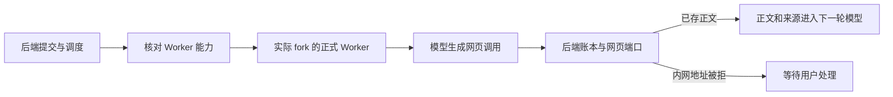

# T-915 正式 Worker 网页能力声明与父子进程贯通

正式构建入口已绑定网页适配器、浏览器资源、搜索和会话端口，以及持久观察恢复。本次增加 `chat.web-read` 能力声明，并在 Worker 内部核验任务需要的网页能力，缺能力时在解析模型凭据前等待恢复。

- 能力开关必须与 runChat 同时存在，单独声明标志不能对外宣称可执行。实际 entry 显式开启，因为对应执行分支和资源已经装配。
- Worker 准入与后端调度器双重检查能力。并未将现有 `/api/chat` 默认入口改成新调度路径。
- 统一 createChatTaskToolHost 新增显式 webRead 选项，复用原网页 host；默认不启用，不复制工具 schema 或执行逻辑。
- 新集成用例使用真实构建产物、fork、私有 IPC、隔离 PGlite/LocalFS、真实领域素材与会话服务；模型是本地 HTTP fixture，不冒充商业供应商。

## 验证

- [入口红测](chat-web-read-entry-red.log)：2 项失败，旧正式 Worker 未声明网页能力，调用未进入模型。
- [能力准入红测](chat-web-read-entry-capability-red.log)：1 项失败、28 项跳过，确认旧 Worker 在未声明网页能力时仍尝试读取凭据。测试后来修正失败记录端口名为真实 commitResult，不把错误端口名作为产品缺陷。
- [入口绿测](chat-web-read-entry-green.log)：2 项通过。缓存命中后正文和原来源确实进入第二轮模型，只有一个已结算工具与一份素材；内网地址被真实 URL 守卫拒绝，工具记录 permission，任务 waiting_user，无第二轮模型、无素材。
- [Worker 生命周期回归](chat-web-read-entry-runtime.log)：31 项通过，包含缺网页能力前置拒绝及有/无运行器的能力声明检查。
- [既有对话与研究入口回归](chat-web-read-entry-existing.log)：29 项 / 2 文件通过。
- 切换到统一工具装配后，[装配红测](chat-web-read-entry-composition-red.log) 两项实际失败，暴露遗漏；补入网页 host 后，[最终统一装配回归](chat-web-read-entry-composition-green.log) 16 项 / 3 文件通过，包括两个真实子进程入口及旧 local/candidate 工具。
- ai-worker/backend 最终类型检查通过。boundary 既有 5 项、无新增；orphan 0 errors / 100 warnings。已执行 pmem sync；[全局对账](chat-web-read-entry-global.log) 仍为 211 errors / 1 warning，与前基线一致，未通过。
- 独立只读复核未发现声明或接线阻断。

本次两项子进程用例没有执行浏览器正文抓取、HTTP 备用搜索或登录恢复，不能单独证明完整网页路径可用。真实 Chromium 资源测试和 ACK 对账测试有各自证据；仍需更广的父子进程故障旅程、完整公共入口迁移与后续工具消费。其他 R-05 入口、旧路径退役、性能、商业供应商与双平台验收继续保留，T-915 未完成。
