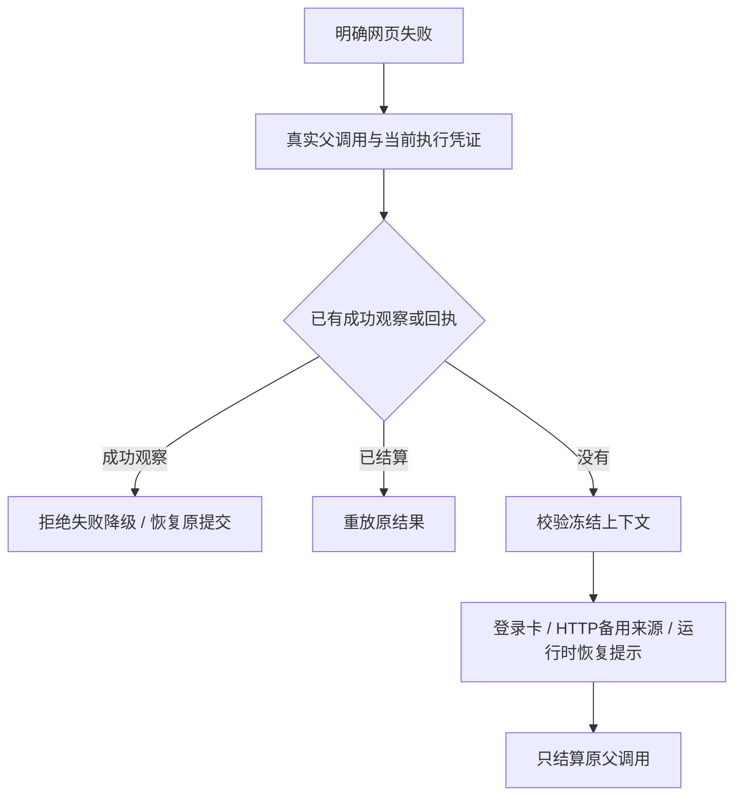

# T-915 网页失败事实结算

成功正文已能恢复提交，但登录、HTTP 被拒及浏览器不可用还需要独立失败回执。本批接通 `failChatWebRead`，失败事实进入原父调用账本与聊天卡片，不重新访问网页或创建素材。

- 契约只接受 `needs_login`、`http_blocked`、`browser_runtime_unavailable` 和有界 `read_error`；禁止提交成功素材、正文、账号、登录域或自报终态。HTTP 状态限定 400–599，备用来源最多 5 条且仅允许无凭据 HTTP(S) URL。
- 登录域来自被冻结的宿主 URL，优先于模型 URL。上下文 reader 新增后端专用 settlement 读取模式，只放宽业务运行状态限制；任务归属、执行凭证、源消息、历史摘要、输入摘要及上下文摘要校验保留，默认仍走 admission。
- 失败结算在同一执行行锁和事务中核验：父调用已启动、属于当前回合及 attempt、没有内部调用或成功观察。与 observe 并发时只有一方成功；已成功提交的回执只重放。
- HTTP alternatives、`httpStatus/loginSuggested`、登录域及空素材/正文窗口由原 `web.read` 卡片逻辑投影；浏览器缺失带 `recoveryState: browser_runtime_unavailable`。普通 HTTP 失败不伪装成必须等待登录。
- supervisor 将明确失败归为 settlement，允许同一执行凭证取消后结算原调用，但该端口不执行新读取、搜索或素材写入。无法确认的宿主回执与取消异常不能由调用者伪装成普通网页错误。

## 验证

- [红测](chat-web-read-failure-red.log)：5 项新增失败，23 项既有通过；失败为新方法不存在。
- [回归](chat-web-read-failure-green.log)：82 项 / 5 文件通过，覆盖网页真实隔离 PGlite/本地素材、聊天研究、开场生成、真实 Worker 入口和 supervisor 既有回归。新失败结算自身通过后端真实端口装配验证，尚不是完整 Worker 网页执行测试。
- 新场景：取消后从冻结 URL 产生登录卡、重复回执、HTTP 备用来源、运行时缺失、成功观察拒绝降级、成功提交后失败只重放、失败/观察并发、伪造字段、跨调用、旧 fence 与上下文篡改拒绝。
- contract、ai-worker、backend、frontend `tsc --noEmit` 均退出码 0；原输出为空。独立只读复核未发现阻断。
- 收尾已运行 `pmem sync` 与 `reconcile`：全局仍为 211 errors / 1 warning，与前基线一致，未通过；boundary 为既有 5 项，orphan 为 0 errors / 100 warnings。历史工程欠债不计为本批通过证据。

Worker 网页执行适配器、缓存复用、搜索配置与启动恢复消费仍需完成，尚未启用生产 `chat.web-read` 能力。T-915 全入口迁移、同条件性能、商业供应商和双平台验收范围不变。
