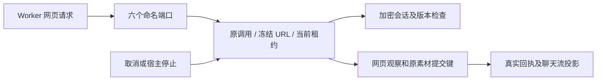

# T-915 聊天网页命名端口与版本化会话

已完成的读取和恢复服务需要一条受控的父子进程通道。本批将网页准备、观察、恢复、提交及会话读写接入现有调度器，素材仍由后端保存，Worker 不能自报已经成功的素材。

## 实现

- 新端口：`prepareChatWebRead`、`observeChatWebRead`、`restoreChatWebRead`、`completeChatWebRead`、`readChatWebReadSession`、`saveChatWebReadSession`。观察、URL 及会话请求严格校验，不能额外提交账号、域名或素材 ID。
- 调度器注入明确的网页服务依赖，工具声明存在但缺少会话装配时拒绝启动。完整能力尚未在生产 Worker 声明，未切换正式入口。
- 会话域来自冻结上下文，复用既有别名查询、状态形状/域边界检查及真实加密服务；CAS 防止旧 Worker 覆盖人工新登录。会话读取共用现有 profile 租约，读取后再次核验，执行结束仍沿原资源证明释放。
- 网页完成必须经后端提交；通用工具 settle 不接受 Worker 伪造的素材结果。完成后复用聊天流投影，重复回执返回原结果。
- `completeChatWebRead` 允许处理迟到回执，但服务和调度器传递宿主停止信号，在新保存的准入及事务授权处检查。已结算回执可以重放；停止后不能借结算类别上传新观察或保存新会话。

## 验证

- [红测记录](chat-web-read-ports-red.log)：首轮 1 失败 / 15 通过，证明新会话操作尚不存在。后附停止探针的 2 个失败使用了未命中事务的 client.query 拦截，**不能作为停止窗口行为红测**；修正为事务 tx.query 后，最终测试明确断言实际命中及回滚结果，不补造旧实现红测。
- [最终回归](chat-web-read-ports-green.log)：61 项 / 5 文件全部通过，覆盖真实聊天工具端口装配、既有研究 Worker、会话、pendingDocument 和 supervisor 回归。
- 隔离 PGlite、真实本地素材存储和真实加密会话服务。验证冻结 URL 域、CAS、跨域拒绝、取消、读取版本期间停止、新保存拒绝、已结算回执重放及 Worker 伪结果拒绝。
- 独立审查指出素材回执行锁与会话内部版本读取之后仍有停止窗口。signal 已传至领域写入边界；新增 4 个真实事务等待点故障注入，均断言命中及无素材/会话落库，`worker_review` 再次独立复核通过。
- [类型检查](chat-web-read-ports-types.log)：contract、ai-worker、backend 通过；frontend `tsc --noEmit` 完成且退出码为 0。
- 没有把直接服务/端口测试宣称为完整生产 Worker 网页读取或真实外部搜索验收。
- 收尾已运行 `pmem sync` 和 `reconcile`：全局对账仍为 211 errors / 1 warning，与本批前基线一致，未通过；boundary 为既有 5 项，orphan 为 0 errors / 100 warnings。本批验证通过不代表全局工程对账通过，既有欠债继续由 T-916 跟踪。

## 未完成边界

Worker 执行适配器、失败和备用搜索结果结算、缓存与搜索配置装配、启动恢复顺序、真实独立进程浏览器链路及正式入口切换仍需继续。T-915 的 R-05 全入口、性能、商业供应商和双平台验收未缩减，任务保持进行中。
