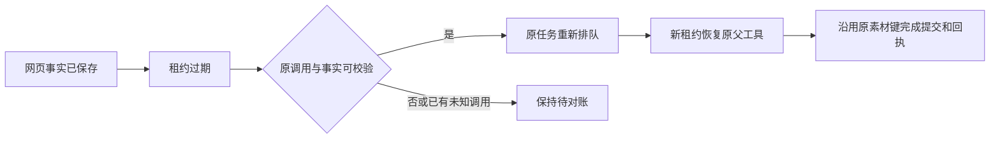

# T-915 网页事实跨租约恢复

网页正文已经读到并保存后，进程退出不应让任务永远停在“结果未知”。本批让调度器识别可校验的网页事实，将原任务重新排队，由新租约接续原父工具，不重新创建素材。

## 实现

- 将网页事实的类型、内容摘要、字节数、任务及调用身份校验提取为共享后端函数。实际素材提交仍额外验证冻结 URL 和真实业务上下文；调度分类不代替提交授权。
- 过期租约恢复、检查点以及 hooks／structured 的恢复判断共享网页事实集合，避免同轮不同工具互相误判为未确认调用。
- 仅当前根模型提出的 started `web.read` 父调用，无宿主执行 claim、无子调用、有唯一完整观察时可以恢复。存在 unknown 或缺损事实的同轮调用仍保持待对账。
- 新 `restore` 在当前租约下再次核验身份，仅更新 `startedAttempt`，不改变观察、预算或素材键。旧凭证不能继续上传或提交。

## 真实证据

- [红测](chat-web-read-recovery-red.log)：9 通过、1 失败。已保存观察的过期任务错误进入 unknown_result，没有重新排队。
- [回归](chat-web-read-recovery-green.log)：初次扩展 99 项 / 4 文件通过；新增混合回合用例后专测 11 项通过，共覆盖 100 个不同用例。
- 隔离 PGlite 和本地文件存储，覆盖观察后过期、提交成功但回执触发器故障、新租约继承、旧凭证拒绝、取消、缺失观察、正文/诊断篡改、跨任务事实、unknown 及混合回合。
- 使用数据库租约过期和结算触发器模拟故障，未伪称真实进程被杀、外网或商业模型验收。
- [类型检查](chat-web-read-recovery-types.log)：contract、ai-worker、backend 均通过；frontend `tsc --noEmit` 也已完成、退出码为 0。
- `worker_review` 独立只读复核未发现本批阻断，要求的混合及负例已补。
- 上批证据文档的通信术语复杂度登记已按 DEC-RUNTIME-055 补齐，不新增架构或发布范围。

## 未完成边界

本批完成后端恢复分类与恢复操作，Worker 命名端口、启动恢复顺序、真实浏览器和会话接线仍须继续。正式聊天入口未启用此能力，Worker 也尚未声明完整网页读取能力。T-915、R-05 全入口迁移、性能和双平台验收保持原范围，不能凭本批回归标记完成。

收尾：`pmem sync` 已执行；全局 `reconcile` 仍为 **211 errors / 1 warning**，与既有基线数量一致，未宣称全绿。边界 **5** 条基线违规、无新增；orphan **0 errors / 100 warnings**。本批未执行全任务 complete，也未发布或操作真实用户数据库。
