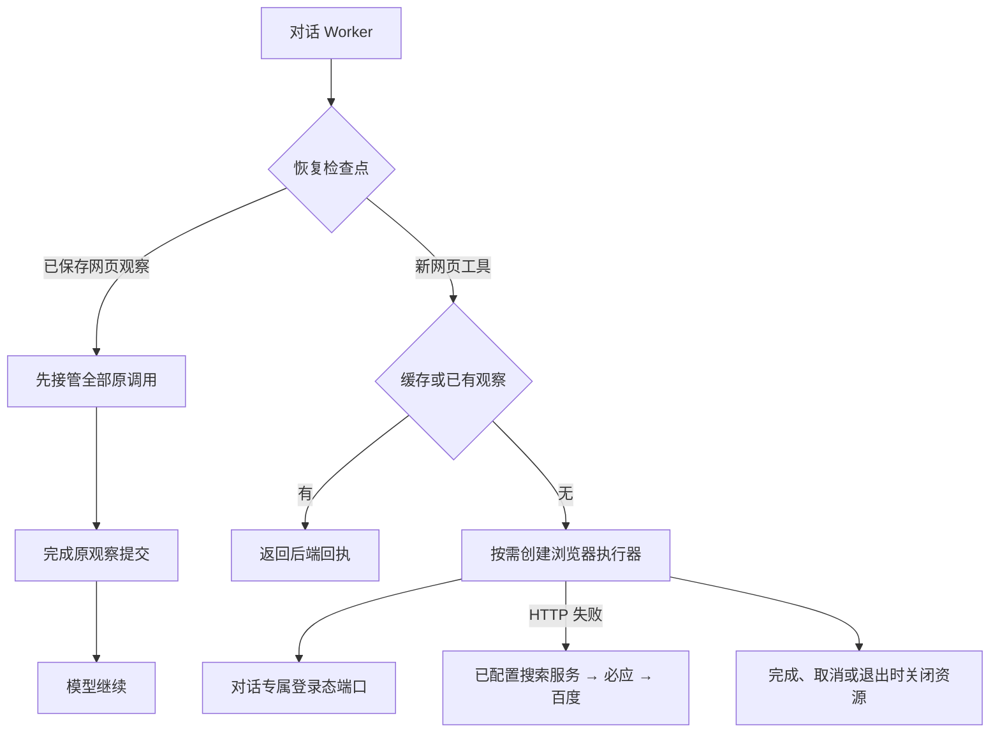

# T-915 对话网页 Worker 资源与启动恢复接线

对话 Worker 已能把 `worker.web-read` 交给网页适配器；本次补齐其浏览器、搜索与登录态依赖，以及正常结束和进程退出的回收。Worker 尚未声明 chat.web-read 能力，正式入口尚未开启。

- `createChatWebReadResources` 共用现有浏览器执行器，不复制网页解析或搜索抓取实现。每次网页调用的私有配置、会话读写绑定当前 callId，不复用其他父调用的凭据响应。
- 缓存命中无需创建浏览器执行器。搜索配置仅在 HTTP 备用来源流程需要时读取；默认注册既有 Bocha/Tavily/SerpAPI 适配器，浏览器搜索使用单引擎原始接口，避免叠加研究搜索的内部回退。
- 配置端口回执未知时停止，凭据不进入观察、卡片或后端调用入参。网页登录态查询验证返回站点；会话持久化沿用原 CAS 与取消语义。
- `chat-worker-run` 读取 replayableWebReadToolCallIds，先恢复全部网页父调用，再完成原持久观察，随后进入模型边界。恢复本身不重新读取网页。正常调用接入 durable wrapper 和网页适配器。
- 资源关闭先 abort、等待已开始的执行器创建，再关闭执行器；重复关闭共享同一 Promise。会中 finally 与 Worker disconnect/SIGTERM 均回收网页资源。

## 验证与边界

- [资源红测](chat-web-read-resources-red.log)：首次缺新模块导致加载失败，没有运行行为测试。
- [恢复红测](chat-web-read-resources-recovery-red.log)：修正测试输入的 apiFormat 后，2 项实际行为用例失败，证明原 Worker 忽略网页恢复列表并提前进入模型；实现后通过。测试在模型创建处主动终止，仅验证恢复顺序与身份回执，不伪装真实模型恢复验收。
- [协议红测](chat-web-read-resources-protocol-red.log)：1 项实际失败，确认无效配置响应原本被当普通网页失败；新增私有响应解析包装，将配置/会话协议异常归为固定未知错误后，[最终整组回归](chat-web-read-resources-final-green.log) 20 项 / 5 文件通过（包括真实 Chromium）。
- [Worker 首轮回归](chat-web-read-resources-green.log)：17 项 / 4 文件通过，覆盖资源、网页适配器、启动恢复及原研究资源。资源用例使用明确执行器/搜索替身。
- [真实 Chromium](chat-web-read-resources-browser.log)：2 项通过。测试仅允许本地 HTTP 站点，执行实际读取和取消；正常读取交回完整正文并保存会话；取消不上传观察、不保存会话；关闭后实际浏览器进程 PID 已退出。宿主端口为测试替身，不是端到端数据库验收。
- [既有 Worker 入口](chat-web-read-resources-entry.log)：24 项集成回归通过，实际构建并 fork Worker，使用隔离数据库和本地模型 HTTP fixture；这不代表本批网页入口已完成实际父子进程全链路验收。
- ai-worker 最终类型检查退出 0；新增协议故障 fixture 的返回类型先被推断得过窄，按真实私有端口声明为 Promise<unknown> 后通过。独立只读复核资源工厂、启动顺序和退出路径未发现阻断。
- boundary 既有 5 项、无新增；orphan 为 0 errors / 100 warnings。已执行 pmem sync；[本次全局对账](chat-web-read-resources-reconcile.log) 仍为 211 errors / 1 warning，与前基线一致，未通过。

仍需处理观察已持久但 ACK 未知时的账本恢复，补实际网页父子进程与后端全链路、生产能力装配、分页证据消费等；完整 R-05 入口迁移、旧路径退役、性能与商业供应商及双平台验收未完成，T-915 保持进行中。
