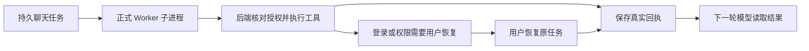

# T-915：正式聊天 Worker 接线与恢复验证

本批将 chat.run 接入现有正式 Worker 二进制与调度池，冻结任务、工具身份与权限由后端核对。没有创建第二套数据库或第二个聊天执行队列。

修复：旧登录/权限阻断在显式恢复后可回放给模型选择新调用，不重复旧动作；已完成的工具不会因后续撤销权限被改写；Worker 不能跳过宿主执行自行提交成功或伪造拒绝；执行前二次权限检查产生的拒绝在恢复时保留原事实。工具 IPC 等待服从任务总截止时间，允许预算内超过 30 秒的真实工具操作。

真实红测：正式二进制缺少 chat.run；宿主伪造结算与历史授权回放共 2 失败；恢复登录/权限共 2 失败；执行前拒绝恢复 1 失败。对应日志随本文保存。

验证：后端 4 文件 29 项通过（含正式 esbuild + fork + PGlite + 本地 HTTP SSE，13 个二进制/旅程用例）；宿主回归 20 项；Worker 生命周期 28 项（含模拟时钟下 31 秒工具成功）。契约校验 3 项，去重合计 80 项。宿主权限测试搬到 integration 目录后 6 项重跑通过，不重复计数。contract/worker/backend 及 frontend 类型检查通过。独立 worker_review 复核未发现本批剩余具体阻断。

边界扫描无新增违规，保留原 5 条；orphan 0 errors / 100 warnings。全局 reconcile 结果另附，不把历史工程债误报为通过。未使用商业模型 API，未改用户数据库，未推送或发布。固定 IPC 时限回归没有声称具备历史红测。

尚未验收：公开聊天入口与完整持久流事件装配、实际工具注册表授权桥接、其余 AI 入口迁移、双平台进程清理、真实商业供应商与性能基线；T-915 保持进行中。

本次最终全局 reconcile 实测 211 errors / 1 warning，exit 1；与前批基线一致，继续由 T-916 跟踪，未消除或隐藏。
