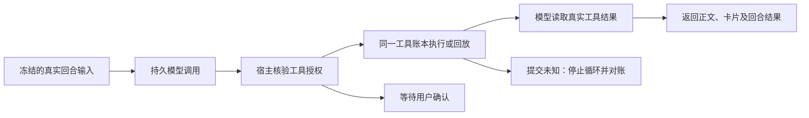

# T-915 持久聊天回合运行模块

2026-09-05。完整聊天进程迁移仍在实现中。

runChatInWorker 把此前集成测试中的手工接线变成正式 Worker 模块：使用冻结输入、持久模型包装器、同一工具账本和检查点执行回合。业务写入与最终任务状态仍属于后端。

图表示模块调用关系，尚未加入官方 Worker 启动入口的 chat.run 分支。

## 实现

每个模型回执保存或回放后，运行模块绑定真实 toolCallId → modelCallId，并保存有序检查点。工具参数由后端账本反查；Worker 不相信 SDK execute 传来的参数作为执行真值。工具调用回执未知时立即中止整个回合，避免 SDK 把异常交给下一轮后继续写入。

授权判定是必填宿主回调，按真实模型/工具调用 ID 判定。需要用户确认时返回原生 approval-requested 卡及 awaiting_confirmation；拒绝时记录绑定原模型调用的无副作用工具回执，并让 SDK 向模型提供拒绝事实。拒绝记录不调用业务处理器。

回合输出包含固定消息 ID、完整 UIMessage、最后模型调用、工具调用引用与结束原因。空输出失败；完整 stop 为 completed；已有可用内容但被长度等原因截断为 partial。明确 429 保留 retry_wait，调用计数/预算仍由后端管理，SDK maxRetries 为 0。模块不自行写消息或标记任务完成。

## 实测

- 从真实聊天源消息、提交服务、数据库账本走到本模块及本地 SSE 的集成 **7 PASS**：正常完成并重放、工具提交未知、待授权后允许、明确拒绝、空输出、长度截断、429。
- 正常/允许/拒绝/截断的回放均没有增加供应商请求；正常工具实际处理器一次，拒绝零次；正常检查点 ready。工具未知时仅一次模型请求和一次处理器执行，工具调用保持 unknown，第二次启动在检查点处停止。
- 待授权首次仅调用模型一次、未执行工具；宿主 fixture 后续改为允许后才执行工具。这里验证回调协议，未经过真实 UI 用户批准流程。
- 既有 Worker 聊天/流式/持久工具 **32 PASS**，旧聊天装配和工具门 **164 PASS**。合计 **203 项不同测试**，不叠加重跑。
- 类型、scope、boundary、orphan 和全局 reconcile 的原始记录见相邻 JSON。供应商为本地 SSE；没有商业模型、安装包或真实子进程验收。

## 限制与真实失败

尚未把 chat.run 加入官方启动输入 union 或 Worker 入口；宿主授权回调、流事件持久保存与消息完成事务仍待正式装配。回合内同参工具复用还需逐次补齐账本关联；现有内存去重不能当作跨重启工具事实。非文字模型内容的完整检查点兼容、script.patch 协议修复与原模型回执的对应也需在正式切换前验证。

首次实现后运行集成通过，没有事前行为红测。扩充场景时，类型检查发现 unknown 分支里误保留了 denied 比较，改成确定次数断言后通过，不把这类类型失败称为 TDD 行为红测。本批无新的独立评审回执。

CodeGraph 已刷新，但 callers 未解析出此跨包调用；rg 与集成实测确认当前消费者是集成测试，官方启动入口仍未调用。全局 reconcile 实测仍为 211 errors / 1 warning。

完整聊天路由、授权续接与 UI、其余 AI 入口、浏览器资源清理、性能样本和双平台验收尚未完成。本批不表示整个任务通过，未发布、未安装。
