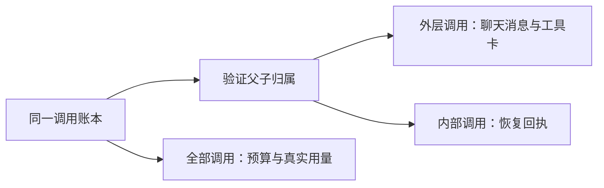

# T-915：内部调用与聊天消息投影分离

检查点和聊天完成服务先验证父子树，再分别处理根调用与内部调用。根调用才进入聊天消息和待补消息列表；内部调用以 childCalls 从真实账本单独返回，包含父调用、状态、顺序、原供应商回执和拒绝原因。内部调用不需要额外消息检查点，不会在父工具完成后永久造成待重放状态。

父工具未完成或内部结果未知时仍要求对账，没有放宽旧 attempt 的恢复权限。所有调用继续参与预算、在途与未知状态判断；最终正文和最后模型只从根调用选取，消息用量包含内部模型。工具授权来源明确拒绝内部模型，工具端口的当前回合判定只看根模型；展示流端口拒绝内部模型内容。普通历史调用的 parentCallId 为 null，保留既有处理。

前置反例 1 failed / 17 skipped：旧检查点错误地把内部模型放入待补聊天消息。实现后六文件 98 项通过，包含新增 11 项：内部回执与消息分离、真实聊天提交到完成的用量汇总与幂等重放、内部 tool-call 无执行权、正文不泄漏、展示流拒绝内部调用、五类损坏父子关系及未知子调用。完成测试使用真实提交、模型回执账本、工具端口、工具卡投影、检查点和最终事务；供应商回执是受控 fixture，不冒充真实商业模型证据。

独立只读代码复核未发现具体阻断，评审者未另行运行测试；按建议补了损坏账本反例。前后端类型检查和边界结果据当场日志保存；边界无新增违规（既有 5 条），orphan 0 errors / 100 warnings。

Worker 的聊天读取暂不消费新增 childCalls，也未开放内部模型执行或父工具恢复的窄端口。本批只建立正确消息与权限边界；生成工具运行、持久恢复接线、正式入口迁移、性能和真实双平台验收继续属于完整 T-915，未完成。

pmem sync 完成并刷新 CodeGraph；当场全局 reconcile 仍为 211 errors / 1 warning，未通过。保留 T-916 工程债务，T-915 未标记完成。
