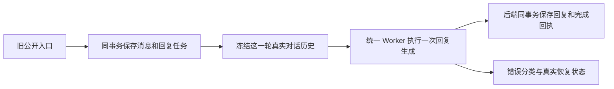

# T-915 旧公开对话入口迁移证据

2026-09-05。此批属于完整 T-915 的持续实现，不能作为整体验收通过或发布依据。

用户通过旧公开 `ai.conversations.messages.create` 发送消息时，用户消息与回复任务现在同事务保存，返回的既有 `modelMetadata.replyTaskId` 指向真实业务任务。宿主仅准备任务、唤醒统一模型 Worker。保存后进程退出的 queued 任务由既有启动扫描恢复。

## 行为与边界

- 新流式 `/api/chat` 仍使用原 `createMessage`，不会由这次改动额外启动旧助手回复。该流式执行链尚待迁移。
- `copilot.assist` 注册为可配置 Skill，保留旧助手定位与复盘经验提示，只输出非空 `reply`。无额外规划模型、无新增浏览器工具。
- 当轮历史从真实会话按已冻结消息 ID 读取；拒绝缺失、重复、错误来源绑定和跨项目引用，后续用户消息不进入前一轮输入。项目上下文读取前经实际项目服务验证。
- 回复提交只接受同执行最后一个已结算模型调用的原文与供应商回执。会话归属、来源消息、任务映射、租约与停止状态均需有效。
- 助手消息、业务结果、AI 任务完成、执行完成及调用 `resultRef` 同一事务。重复提交不追加消息；终态写失败回滚所有写入。
- 删除旧 `copilot-runner.ts` 及导出，根装配不再 fire-and-forget 调用模型或把“暂时无法回复”伪装成助手产物。失败通过既有任务状态回读。

## 实测

- Backend 7 文件 **53 PASS**：消息原子保存、并发历史、准备归属、完成幂等与事务回滚、旧公共契约与验收、Skill 注册表、共享 dispatcher。
- 真实构建 Worker 子进程 + 本地 HTTP 模型服务 + 隔离 PGlite：**3 PASS**。公开消息保存后尚未准备执行，重新构建准备服务扫描恢复；成功只产生一次模型调用、一条助手回复；401 进入 `waiting_user`，重复唤醒无新模型调用、无假回复；首次 503 进入 retry_wait，到持久重试时间后再次真实 fork 调用成功，最终一条回复。
- Worker 4 文件 **89 PASS**：结构化生成、执行生命周期、模板与冻结 Skill 运行时回归。
- 合计 **145 项不同测试**。重跑不重复计数。模型服务为本地 fixture，未调用真实商业供应商；没有桌面安装包或 UI 端到端结论。
- Backend、Frontend、Worker 类型检查退出 0；边界扫描 5 条既有违规、0 新增；orphan 0 errors / 100 warnings；任务范围检查 `[]`。

## 如实保留失败与限制

首次消息服务红测为 4 个缺失方法失败；准备适配器与完成服务首次红测因实现模块不存在，未进入测试用例，不称为行为红测。相关原始日志完整保留。

过程失败包括新增 Skill 未同步显式注册表、集成测试把可选 executionTaskId 的 undefined 写成 null、前端 unknown 类型访问，以及一次注释替换误删流式保存方法。均在本批修复并重跑相应测试；流式保存方法正文与原 HEAD 保持一致，仅更新注释。

本批尚未取得新的独立代码评审回执，不标为评审 PASS。整体 reconcile 结果在相邻 evidence JSON 记录；既有 T-916 工程对账欠债不抹除。完整 T-915 的新流式对话、其他 AI 入口、生产浏览器进程清理、真实供应商、性能样本及双平台安装包验收仍未完成。本批也未单独验收准备阶段失败后旧对话 UI 的恢复操作，不据任务 API 可回读推断 UI 已完成。
