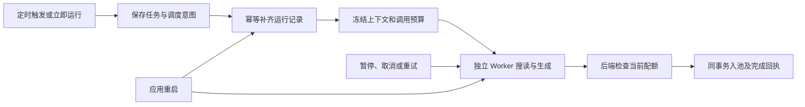

# T-915 每日选题执行迁移证据

本轮把 `scheduled.topic.daily` 接到已存在的独立 Worker 和持久调用账本。定时任务仍按原定位、评论、知识、经验、热点及偏好护栏出题，后端按当前日供给原子入池。完整 T-915 尚未完成，本文不代表全部 AI 入口、供应商或安装包已验收。

## 实际改变

- 退役生产根的 `collectDailyTopics` 调用、旧 collector 文件及其专属测试；调度和普通生成共用已有执行领取机制。每日成功使用专门完成端口，不能绕入普通待采纳候选接口。
- 每日多依据准备只读取真实服务；热点搜读与抽取在 Worker 执行，保留原 `topic.generate` 最终模型步骤，没有新增规划模型。
- 额度已满或未配置模型时，冻结真实跳过决定，Worker 在取模型凭据前完成，零模型调用。回执记录检查日及观察到的额度，不把昨日决定说成今日额度已满。
- 后端验证真实 job、run、AI task、execution、账号及最后已结算模型回执。同一事务写候选、运行终态、任务终态与回执，失败完整回滚；重复提交不重建已删除候选。
- 日计数覆盖完整 UTC 自然日，无 1000 条分页截断。每日补足与候选新增共用事务互斥；保留旧偏好调整、探索位和来源归一。
- 自动化父任务只跟踪原子执行，等待时不占住整个分钟调度。父控制转发到子任务；即使尚未 attach，真实调度归属也能阻止父取消后的新动作。0082 索引让等待中的父任务继续占据同作业互斥位。
- 等待登录、暂停、未知结果等不会被僵尸清理误杀。失败后显式重试会在同事务重开原 run，不重置账本、预算或截止时间。
- 任务创建与 run 创建之间的崩溃，由严格冻结的 `scheduledRun` 意图恢复。正常触发、立即运行及启动恢复共用 `ensureRunForTask`；历史已有 run 可复用，缺失意图的孤儿不会凭时间猜测重建。
- 三个网页源正常需要至少 8 次调用，旧统一 6 次上限会提前失败。现在首次准备按冻结步骤加上 search/read/extract 必要次数；普通定位额外为 0，已绑定任务恢复不重算，时间和 token 上限不变。

## 验证与真实边界

最终合并去重覆盖后端 198 项、Worker 95 项、契约 4 项，共 297 项。后端首轮 21 文件有 196 通过、2 失败：一项读预算测试仍把新准备预算当固定总额，已显式设置原断言要求的总额 2；另一项在并发创建数据库时超时。限定 2 workers 后复跑相关 2 文件，20 项通过。保留首轮失败日志，不冒充一次全绿。

后端、前端、Worker 类型检查通过。代码清单及 SHA-256 见 `daily-topic-migration-evidence.json`。

真实构建 Worker 子进程、本地 HTTP 模型与 PGlite 验证了并发额度、重复调度、零调用 skip、三网页源生成及父任务跟踪。恢复组合测试覆盖 cron/runNow 在 createTask/createRun 间的真实恢复扫描。Daily 模型测试的热点读取回执通过真实服务端口预结算；不代表这些测试当次访问了外部网站。Worker 回归另含真实 Chromium/本地网页读写与取消测试。

已发生的行为红测包括：正常多信源超预算、partial 被错误提交、通用候选端口绕过每日完成、等待父任务缺少唯一互斥、失败 run 重试后不能继续。新增服务缺模块/缺函数的测试先写失败，以及中间测试 fixture 类型错误，均不冒充历史生产行为红测。

入口、完成事务、调度意图已有独立审查记录；最新预算调整和 retry 的末轮独立复核因协作代理额度中断，仍待补。主会话接手了代码检查、组合回归及类型修复，不将自审写成独立评审通过。

## 尚未完成

本轮 boundary 无新增违规（既有 5 条）；orphan 0 错误/100 警告；scope 检查空错误。reconcile 为 211 错误/1 警告，与本轮前基线一致，保留 T-916 全局失败，不写成全绿。T-915 仍需迁移剩余对话、预览、脚本、媒体与采集后处理入口，补真实供应商、性能样本、授权/恢复界面及双平台安装运行验收；本轮没有推送、发布、安装替换或访问用户生产数据库。
