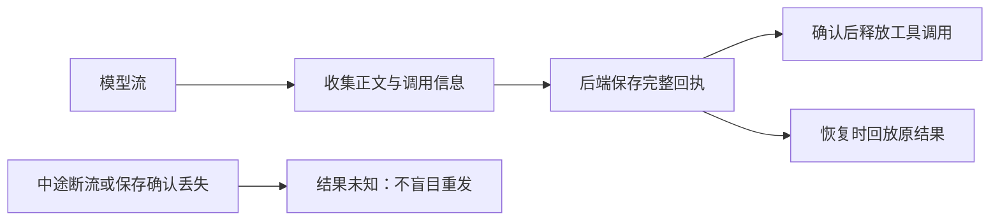

# T-915 流式模型回执与恢复证据

2026-09-05，承接完整聊天迁移 R-05。本批提供模型层基础，尚未接入 `/api/chat` 或正式 Worker 入口。

模型结果保存确认后，才允许上层执行它提出的工具调用。若模型已完成、数据库已保存而确认消息丢失，恢复时读取原结果，不再次向供应商请求。无法确认完成的半截输出保持结果未知。

## 实现与边界

新增 durable-stream 模型包装器，复用 reserve/start/settle service ports，Worker 不连接数据库。私有回执增加可选版本化流帧，保留现有 canonical content、usage 与大小限制。文件字节转换成 SDK 支持的 base64，回放恢复 URL 与时间类型。

文字可逐步流出；从工具调用或 finish 起的后续帧按原序暂存，收到保存成功回执后才释放。取消期间不发布工具调用。明确 429/5xx 拒绝和网络结果未知分别处理；不完整流通过 SDK error 帧报告，不将已有部分文字当作成功。保存确认未知时不覆盖可能已经成功的结算记录。

## 验证

- 包装器 10 项测试通过：实际 SDK 消费、回放、工具调用顺序、保存失败、断流、错误帧、明确拒绝与未知、取消、文件与时间编码，以及真实 SDK 连接本地 SSE 的工具调用。
- 实际数据库与模型端口 2 项通过：正常保存；数据库保存成功但确认消息丢失。两者重建包装器后均回放成功，供应商 HTTP 请求均为 1，账本仅一条 settled，真实 usage 保持 5 tokens；同操作键修改问题被拒绝。
- 本轮此前相关回归 Worker 79 项、Backend 33 项通过，其中重复包含旧版新增测试 9+1 项。加入本次新增 2 项后共 **114 项不同测试**，不累计重复运行次数。
- 本地 SSE 是隔离供应商 fixture；数据库是隔离 PGlite。数据库测试借用既有 model.structured 冻结输入，仅证明账本兼容，不是聊天公开入口验收。
- 相关类型检查、boundary、orphan、scope 与全局对账原始日志见相邻 JSON。全局 reconcile 仍是 211 errors / 1 warning，未全绿。

## 真实失败与待完成

首次红测因为缺少实现文件，未执行行为断言。首次实现将流异常交给 controller.error，实际 SDK 没有触发预期 onError；改用 SDK error 帧后通过。真实端口首次测试发现请求包含 undefined，规范为 IPC 等价 JSON 后通过。两次类型检查发现测试 fixture 缺少 V4 字段和 DOM 异步迭代声明，修复后通过。格式化命令因本地未安装 prettier 失败，未安装新依赖。

本批没有新的独立评审回执，不标记评审 PASS。当前包装器未连接正式 Worker 入口；工具副作用还需要持久工具账本绑定，不能从模型回放推导出整个工具链去重。完整聊天的输入装配、授权续接、卡片与消息事务、订阅和取消 UI，以及 T-915 其余入口迁移、性能和双平台安装包验收仍待完成。
