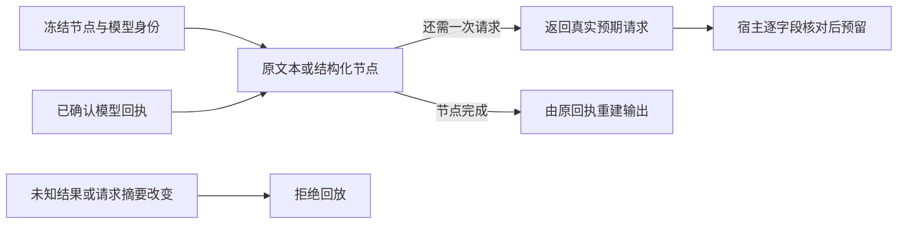

# T-915：真实生成节点的无网络回放验证

开场工具的模型预留已使用原文本节点生成预期请求，再逐字段比较 Worker 请求。共享回放器同时能运行原结构化节点，下一步共享聊天子模型端口可以复用其降级和修复判断，无须另写一套结构化策略。

实现：

- 回放模型没有网络实现；provider 的 generate/stream 和账本 start/settle 均抛错，只有 reserve 可以消费已确认回执或截获下一请求。未使用真实供应商实例或凭据。
- 消费前核对规范 JSON 的请求摘要，unknown 和普通 rejected 必须先对账；只有原明确 STRUCTURED_PROTOCOL_UNSUPPORTED 记录能触发结构化协议降级。
- 节点结束必须消费全部回执；不能忽略多余尾记录。下一请求由内部唯一异常对象截停，不将任意异常当作可提交请求。取消在开始、消费和结束处核对。
- 结构化验证执行同一 runStructuredNode，所以原生成功、直接从原文本解析、文本兼容请求和 completion-policy 修复均保留原规则。修复提示由原对象和原策略推导。
- hooks 服务移除手工 expectedPrompt/字段白名单，改用真实 SDK 节点请求比较，仅保留原 toolChoice:auto 可以省略的等价兼容。
- 通用 replayGenerationNode 的 execute 是可信代码回调，不对任意第三方回调承诺无网络；当前暴露的文本/结构化封装不会执行外部 I/O。不得将通用回调暴露为 Worker 任意执行端口。

当场验证：

- 回放及原结构化/完成策略三个文件共 38 项通过；其中回放 9 项，含原生成功、协议拒绝后文本成功、已有 fenced JSON 直接解析、未知/普通拒绝、请求/身份篡改、取消和多余回执，以及真实完成策略推导修复请求、篡改 repair prompt 拒绝。
- 原 hooks 持久服务 44 项通过，真实独立 Worker 集成 13 项通过；均使用本地测试模型，不是商业供应商验收。
- ai-worker/backend 类型检查通过；独立只读评审未发现具体阻断，评审者未运行测试。
- 本轮是重构与回归，未补称前置红测。主聊天完整挂载仍有上一批已证实的 13 项缺口，本轮没有改动工具清单或将失败改为预期失败。

共享结构化子模型端口、首次节点输入持久冻结、专属模型凭据绑定与候选完成投影尚未接通；不能把该回放器单独视为完成 Worker 迁移。T-915 的完整性能、商业模型及双平台验收仍未完成。

最终对账：pmem sync 已执行；reconcile 仍为既有 211 errors / 1 warning，未通过。boundary 剩余 5 项，无新增；orphan 为 0 errors / 100 warnings。精确写集预检通过。
