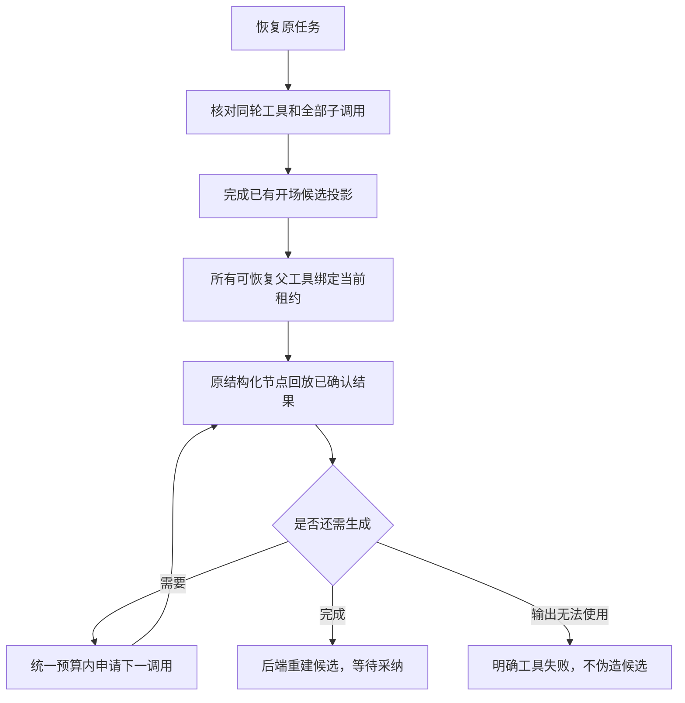

# T-915：聊天结构化生成进入真实 Worker

日期：2026-09-06。基于 `3e9a0069`；用户授权和 DEC-RUNTIME-055 范围不变，T-915 继续 BUILD。

选题补全和定位生成现在由独立 Worker 运行原结构化节点，后台只保管权限、冻结输入、调用记录和候选。进程重启后先核对所有同轮工具，再从已确认结果继续；不会把最后一次模型返回直接当成整项生成完成。

## 实现与边界

- Worker 通过共享命名端口取专属模型、冻结 Skill 和原输入；实际 `runStructuredNode`、供应商调用与格式降级在 Worker 中执行。真实入口声明 `chat.structured`；未提供实现的注入运行器仍不具备该能力。
- `recoverableChatNodeParents` 统一 hooks 和 structured 的恢复判定。只接受当前模型真实提出、冻结定义吻合的父工具，连续逻辑序号和合法拒绝重试链；未知、跨任务、未知用量、未确认子调用或额外在途父工具均不能自动重放。具体下一请求仍由宿主原节点回放逐字段核验。
- 已确认坏输出可继续原有文本降级或局部修复；只有回执全部消费且原节点不再请求生成时才投影明确失败。坏输出不代表供应商提交结果未知，也不产生候选。
- 保留原任务 deadline、预算和调用身份；401 等待实际用户恢复，429 按调度时间恢复，取消与结果未知不自动发新调用。测试能力缺失使用监督器明确过滤能力的 fixture，不再声称真实新 Worker 缺少能力。
- 删除已经没有生产消费者的 `chat-hooks-recovery.ts`，原开场恢复测试改为验证共用分类器。

## 当场复现与修复

独立只读审查发现多父工具恢复顺序错误：逐个 `restore → run` 会在第一个节点申请修复时被另一个旧 attempt 的父工具阻断。实际恢复旧顺序跑两个结构化父工具中断用例，得到 `unknown_result` 而非成功，见 `generation-worker-multiparent-red.log`。修复为先恢复整个集合，再运行节点。补充真实 Worker 的两结构化父工具、开场加结构化混合父工具中断回归。

最初缺能力红测另留 `generation-worker-entry-red.log`。测试期间修正了旧 hooks 复制用例的无效 topic 参数、坏输出需要先完成文本降级的断言、读取不存在的测试字段及假定两个并行子调用请求顺序固定；这些属于测试修正，不能算产品缺陷。多父断点最初依赖 100ms 定时器，在并行负载下漂移，现改为两个真实子调用结算后的屏障；取消等待也显式给出启动等待时间。保留最终复测证据，不冒充历史 TDD。

## 验证与尚未完成项

- 共享生成、开场、checkpoint、持久任务与恢复分类器：105 passed / 5 files。删除旧 helper 后开场与分类器复验 60 passed / 2 files（含重复覆盖，不累加为新用例）。
- 真实进程测试组合：42 passed / 3 files，包含当时 17 个结构化场景、14 个原 hooks 场景、11 个 supervisor 场景。之后补混合恢复单测通过；最终完整结构化文件 **18 passed**，结果见 `generation-worker-final.log`。
- 运行时回放、Worker、durable tool、结构化 generation：98 passed / 4 files；contract：11 passed / 3 files。
- backend、ai-worker、frontend TypeScript 通过。供应商均为本地 HTTP fixture；没有冒充真实商业模型或桌面安装包验证。
- 完整真实聊天装配没有缩减冻结工具清单。启用 structured 端口、冻结生成配置和真实账号 Skill 后，未迁移工具从 13 个降至 11 个：`topic.generate`、`script.draft`、`publish.package`、`cover.generate`、`knowledge.distill`、`calibration.diagnose`、`material.gather`、`material.screenshot`、`web.read`、`local.read`、`material.generate`。该完整旅程仍 FAIL，模型请求为 0，见 `generation-worker-fullscene.log`。
- 独立只读 `/root/worker_review` 复核恢复顺序、坏输出判定、能力声明后未发现新的具体 blocker；审查者未运行测试。其建议的真实混合父工具回归已补上并通过。
- 工程门卫与最终提交检查结果在本文件末尾记录；本次仅在既有 IPC 预算内重绑 Worker 文件精确哈希。

正式 `/api/chat` 仍未切换。所有 R-05 入口迁移、旧路径退役、至少 30 次同条件性能样本及真实商业模型/macOS/Windows 验收仍待完成，不提交 T-915 完成状态；没有 push、发布或修改用户业务数据。

最终工程检查：pmem sync 已执行；reconcile **211 errors / 1 warning**，未恢复全绿；boundary 剩余 **5** 条基线违规；orphan **0 errors / 100 warnings**；精确 write-set preflight 与代码 diff 检查通过。原始日志入暂存区后，全量 diff 检查提示 8 个日志文件末尾空行；保留原始输出未改写。提交钩子提示 `Can’t find lefthook in PATH`，不能将提交成功视为钩子通过。上述原始输出随本次证据保留。
