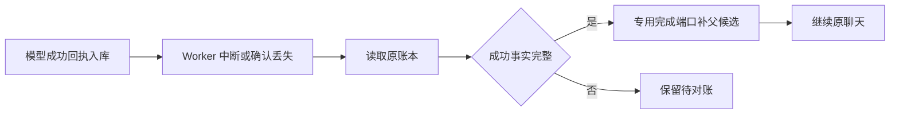

# T-915：子模型已成功后的父候选恢复

开场子模型回执已经入库，父工具尚未保存候选时，即使 Worker 被强制停止，新执行也能直接补回候选并继续原聊天。成功子模型不会再次请求；原预算、操作键和用量不重置。

共享纯函数只识别可以进入专用完成端口的父调用：冻结聊天工具为 script.hooks/proposal/worker.script-hooks；父处于 started、无宿主执行 claim；其原根模型工具引用与操作键匹配；早期子调用全为明确拒绝，最后子模型有合法成功回执和已知用量，父子归属、顺序及重试链成立；其他在途或未知调用不会被忽略。

过期租约回收和检查点使用同一判定。暂停、取消及 deadline 保持原先优先语义。这个判定仅允许进入专用完成流程；真正完成仍复用原服务的账号、工具绑定、权限、模型身份、提示词、子操作键与锁内回执摘要核对。Worker 对完成候选直接调用完成端口，不再预留子模型，也没有扩展通用 unknown 的重试权。

子结算确认丢失但 Worker 仍在运行时，会先请求宿主依据已保存回执完成。没有完整已知子结果时，宿主拒绝，原任务仍进入待对账；不会改成自动重发。取消后也不发起完成请求。

当场证据：

- 前置断言红测：实际子结算成功后强制停止 Worker，原代码将任务变成 unknown_result，1 failed / 7 skipped。
- 第二个前置断言红测：宿主真实子结算已完成，故障包装丢弃成功确认，原代码将成功误记未知，1 failed / 12 skipped。
- 最终 13 种真实 Worker 集成模式通过，包括此前成功/取消/401/429/400、子成功后强停恢复、未知子强停、强停后取消、deadline 到期、暂停后显式恢复、成功子结算确认丢失。
- 强停通过真实 supervisor.stopExecutionTree 完成，返回 true 后再验证父 started、子 settled、用量 7；宿主未被杀死，随后关闭旧调度器并创建新宿主/Worker，以注入时间推进原租约过期。不是宿主进程断电或数据库重新打开的验证。
- 子成功恢复及确认丢失路径总共仍只有 3 次模型 HTTP：第一次聊天、一次开场生成、最终聊天；总用量 17。未知、取消和 deadline 反例停在 2 次；暂停期间同样没有第三次请求，显式恢复后才完成。
- 12 项事实反例覆盖未知子、缺用量、仅预留、坏回执、宿主执行 claim、跨任务子、倒序、非原工具、错误账号、错误冻结执行声明、其他在途调用和多个成功子。
- 六文件后端回归 120 项通过；后加一项确认丢失的最终集成 13 项通过，后端不同测试合计 121 项。Worker 三文件 50 项通过，共 171 项。
- 独立只读评审未发现本批新增阻断；评审者未独立重跑测试。
- contract、ai-worker、backend 与前端类型检查通过；源码 diff 检查通过；边界保留既有 5 条、无新增；orphan 0 errors / 100 warnings。日志只规范化末尾空行。

尚未证明：宿主进程真实断电及数据库重新打开；已经被旧执行标成 unknown 的历史父记录；父工具尚无子调用时的授权/预算拒绝；所有调用预留/启动窗口的暂停与重启；正式业务工厂、/api/chat 迁移、完整性能与双平台包。测试供应商是本地 HTTP fixture，不代表商业模型验收。T-915 保持进行中。

pmem sync 完成；全局 reconcile 保留 211 errors / 1 warning，与上一批相同，T-916 欠债仍在，未宣称整体完成。
