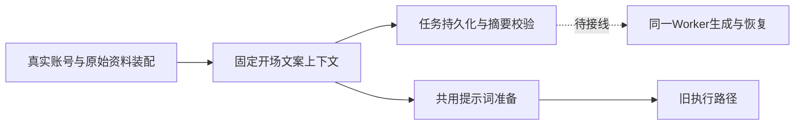

# T-915：开场文案冻结上下文与共同准备逻辑

真实聊天装配在 script.hooks 已挂载时输出六项原始资料：选中标题、定位摘要、项目硬约束、用户素材、参考素材和知识摘要。持久准备将它们验证、深拷贝进宿主上下文，随现有真实任务事务保存，读回受原摘要保护。没有该工具时不生成此快照；新增字段可选且无默认值，旧宿主上下文摘要保持原样。

旧 generateHooks 与待接入 Worker 将使用相同 prepareScriptHooks 和 finalizeHookItems，避免生成提示词与可溯资料漂移。旧 buildChatAssembly 不对外暴露新增内部快照。选择标题、方向、系统提示、硬约束和候选处理保持原行为，主模型凭据仍只在原执行时取得。

独立评审发现双重 trim/slice 会改变 Unicode 截断边界尾空格，前置反例失败后已修复：extraBrief 继续只在既有工具层规范化，prepareScriptHooks 原样消费该值；未来 Worker 准备端口必须沿用工具层相同规则，不得直接传未规范化的原始参数。评审最终无未决阻断，评审者未另行运行测试。

前置红测：装配快照缺失 1 failed / 145 skipped；Worker 准备函数缺失 1 failed / 4 passed；Unicode 边界 1 failed / 5 skipped。最终 backend 两文件 167 项、Worker 6 项，共 173 项通过。包含真实装配账号和对象隔离、真实提交/reader 持久化与摘要防篡改、旧聊天装配全部回归和 Unicode 边界。三包及前端类型检查通过；没有访问商业模型或用户数据库。

边界无新增违规（既有 5 条）；orphan 0 errors / 100 warnings。Worker 内生成、父工具候选验证、专门恢复端口和正式聊天组合根仍需接入，不能据本批宣称 T-915 完成。

pmem sync 完成并刷新 CodeGraph；当场全局 reconcile 仍为 211 errors / 1 warning，未通过，保留 T-916 工程债务和 T-915 完整待验范围。
