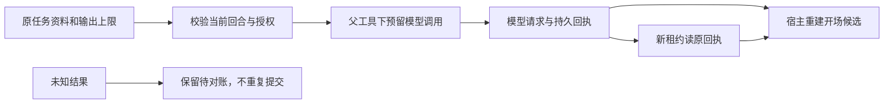

# T-915：开场生成宿主准备、结算与已知结果恢复

开场生成的宿主服务已能按真实任务、账号、原工具参数和原资料准备模型请求，并从已结算的子模型回执重建候选。它仍是待接线的内部服务，尚未导出为 Worker 命名端口；本批不宣称正式聊天已经迁移。

输出上限经 prepareDurableChatTurn 的可信配置参数在首个 await 前复制，随现有 hostContext 与摘要保存；缺少原配置的历史任务不能拿当前默认值补执行。调用请求仅接受纯文本参数，保持既有提示词与 extraBrief 规范化。真实 ai@7.0.4 请求即使没有工具也会带 toolChoice:auto，本批按实际请求兼容该字段；额外工具、采样参数、providerOptions、响应格式和请求头被拒绝。

普通结算禁止 unknown 转成功、禁止新 attempt 首次结算旧 started 调用；同一原执行取消后的实际回执仍可记账，已结算回执可幂等重放。授权等待后和预留、启动、完成事务中复查根回合。父候选只从真实子回执生成，完成前在任务行锁内重新验证完整子调用事实。已确认但不适用的非文本模型响应保留用量，并结算明确错误，不冒充未知提交。空候选保留既有行为。

当场证据：

- 初始服务缺文件红测不是断言红测；初始测试补 modelMetadata 时误传 null 导致建数失败，已修为真实 AI service 创建消息，未把 fixture 错误计为产品反例。
- 结算漏洞断言红测为 3 failed / 2 passed；授权回合竞态为 1 failed / 6 passed；冻结配置缺失为 1 failed / 145 skipped；非文本回执处理为 1 failed / 15 passed。
- 最终四文件 210 项通过，包括原聊天装配和提交回归。测试 fixture 改走 AI service 后，hooks 21 项再次通过；没有跨模块 repository 导入豁免。
- 本地 HTTP fixture 配合真实 provider 工厂、generateText 与 durable wrapper，完成一次生成后重建包装重放，HTTP 请求仍为 1；候选与原回执一致。另有真实任务暂停/恢复、新租约完成已结算子模型的父工具测试。
- 三包与前端类型检查通过；边界检查初次发现测试跨模块 repository 导入，改为 AI service 后恢复既有 5 条、无新增；orphan 0 errors / 100 warnings。
- 独立只读评审确认本批结算、回合复查、冻结输出上限与候选重建没有新的阻断；评审者未另行重跑测试。

剩余接线前要求：冻结并核对真实主模型身份（当前 modelId/provider 仍未与主模型绑定）；显式声明 Worker 执行工具；接通命名端口、工具卡投影及 Worker 内生成；限制通用端口绕过子调用授权；接通冷启动已知结果恢复。当前测试不是完整 Worker 三次模型往返，也不是商业供应商或安装包验收。正式 /api/chat 仍走旧执行路径，T-915 保持进行中。

pmem sync 已完成；当场全局对账仍为 211 errors / 1 warning，本批范围授权与复杂度检查通过。原始结果见 hooks-host.reconcile.log，不以本批通过的测试替代 T-916 的既有失败。
