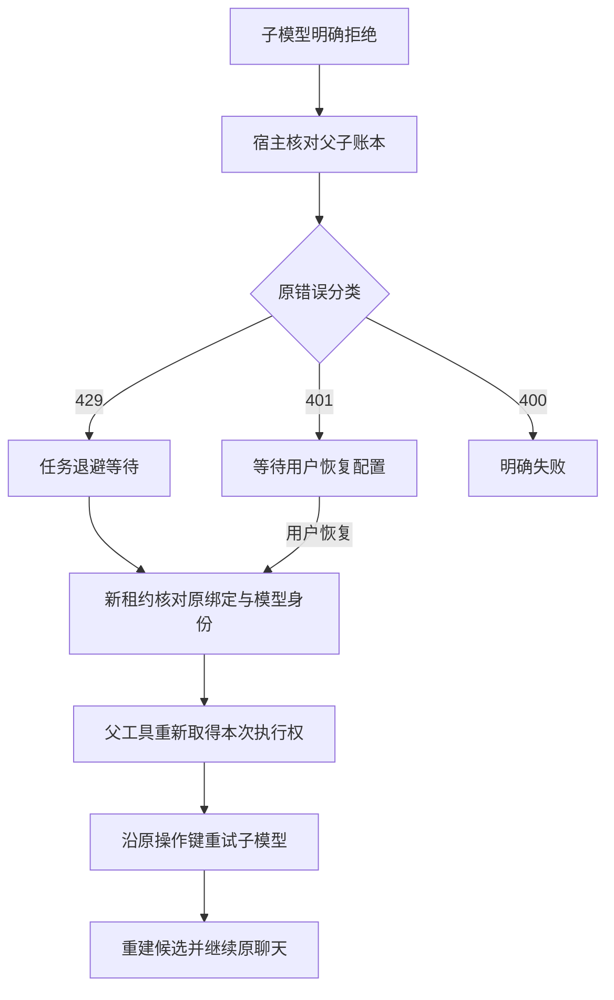

# T-915：明确子模型拒绝的持久恢复

同一聊天任务的开场子模型明确返回 429 时，父工具保留进度，现有任务调度器保存 Retry-After 与退避时间；到期可由新宿主、新 Worker 继续原调用。401 等待用户恢复模型配置，400 明确失败。网络提交未知仍不得自动重发。

本次新增 failChatHooks、restoreChatHooks 两个严格命名端口。首次失败必须核对当前父工具、所有子调用明确拒绝、最后子调用确属当前 attempt，才能交给原 outcome service 保存任务状态。通用失败入口不再只看最后一条拒绝，而会拒绝忽略任何其他 started/unknown 调用。没有另外增加 SDK 重试或 Worker 退避循环。

检查点仅为持久 retryOfCallId 指向的明确拒绝子调用提供专用恢复入口；恢复仍重查原工具声明、账号上下文、模型身份、提示词和操作键。父 startedAttempt 在原任务行锁内更新；子重试需要任务保存的 retryOfCallId、旧 attempt 的真实拒绝源和已经恢复的父工具。同一 attempt 不能直接指定子 ID 绕过等待。所有新子调用继续计入原预算和 deadline；原聊天模型请求只回放，不重新发送。

fail 回执可以同键回读。若已保存等待或失败后 IPC 回执丢失，Worker 最多重读一次相同宿主回执；这是读取已发生事实，不是重试供应商。账本也会阻止将已明确失败、没有宿主执行 claim 的父工具覆写成 unknown。failed 回放核对实际父子、原错误码、最后调用与 attempt，不把为空的 retryOfCallId 当成恢复凭据。

当场验证：

- 真实 Worker 前置红测：401 与 429 均错误成为 unknown_result，2 failed / 2 passed。
- 独立评审反例：直接绕过任务许可重试、已挂起回执重读失败，2 failed / 29 passed；修复后通过。
- 明确 failed 的回放前置红测：1 failed / 31 passed；修复后通过。
- 实际构建 Worker，隔离数据库和本地 HTTP fixture 覆盖 7 种场景：正常、流中取消、401 等待、401 显式恢复并轮换 token、429 到期后新宿主/新 Worker 恢复、429 已保存失败回执丢失后恢复、400 已保存失败回执丢失后保持失败。
- 两种成功恢复都只有原聊天、一次拒绝子请求、一次成功子请求、最终聊天共 4 次 HTTP；根模型仅 2 条，子重试沿原 operationKey/retryOfCallId，成功用量仍为 17 tokens。
- 后端最初七文件 103 项通过；后续新增 failed 的服务与集成两项，最终相关三文件 61 项通过，合计后端 105 项不同测试。Worker 56 项、supervisor 19 项、contract 3 项通过，共 183 项不同测试。
- contract、ai-worker、backend 与前端类型检查通过。
- 边界无新增违规，保留既有 5 条；orphan 0 errors / 100 warnings。源码 diff 检查通过。原始日志仅规范化末尾空行。
- 上一批提交导致三个 IPC 复杂度条目 hash 过期，独立评审确认仍在原授权范围后重绑具体文件 hash 和 reason，保留非验收声明；未降低门卫要求。

范围限制：这是已明确收到子模型拒绝的恢复。父工具尚无子调用时的授权/预算拒绝、子已成功但父候选未保存时的崩溃恢复、正式聊天准备器/工具工厂装配与 /api/chat 切换仍未完成。也不代表商业供应商、完整性能基线或双平台安装包验收。T-915 保持进行中。

pmem sync 完成；全局 reconcile 仍为 211 errors / 1 warning，保留 T-916 既有欠债，不标记全绿。
