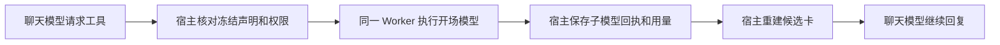

# T-915：同一真实 Worker 执行开场子模型

聊天 Worker 现在可以在原任务内执行开场生成，再继续最终回复。候选只由宿主按实际模型回执重建；内部文本不进入聊天文本流，子模型用量计入同一本账。

新增五个严格的内部端口和 chat.hooks 能力声明。冻结工具的 execution 字段可省略，历史输入摘要保持原值。声明为 worker.script-hooks 的节点必须是 script.hooks/proposal，宿主装配必须匹配声明，即使误带旧 execute 处理器也不会执行。通用模型启动、结算、生成保存端口均在账本锁内拒绝子调用，避免绕过专用校验。子模型结算属于 settlement；准备、启动和完成仍属于 admission，取消后不会生成新候选。

当场验证：

- 实际构建并启动独立 Worker，通过本地 HTTP fixture 完成聊天、子模型、最终回复三次请求；数据库保存三个模型调用，其中一个子调用，总用量 17 tokens，候选卡存在，聊天文本流仅含最终回复。
- 子模型 HTTP 返回中途取消：任务 cancelled，只有两次请求，子调用 unknown、用量 null，无第三次请求。
- 前置成功链路断言红测为 unknown_result 对 succeeded；通用端口四项断言红测、契约两项红测均有原始日志。新增宿主执行旁路与声明替换验证在实现后补充，不声称前置红测。
- 成功/取消、专用服务和子端口共 31 项通过；Worker runtime 28 项通过；契约 2 项通过。
- 后端六文件回归最初 35 passed / 2 failed：失败是 supervisor 对旧能力数组的精确断言。更新实际能力断言后，该文件 11 项全部通过，另五文件之前已通过；合计 37 项通过。以上共 98 项不同测试通过。
- contract、ai-worker、backend 和前端类型检查通过。边界无新增违规，保留 5 条基线；orphan 0 errors / 100 warnings。git diff --check 通过。
- 独立只读评审没有发现当前成功/取消线路的新旁路；评审者未独立运行测试。

仍未完成：明确的子模型拒绝（例如 401/429）、准备授权失败或预算拒绝可能被外层记为父 unknown；自动重试和冷启动父候选恢复需要按账本事实继续修复。未知提交不可自动重发。真实业务准备器及工具工厂还没有开启 Worker hooks；正式 /api/chat 仍是旧入口。测试是本地供应商 fixture，不代表商业供应商、性能基线或安装包验收。T-915 保持进行中。

pmem sync 完成。全局 reconcile 仍为 211 errors / 1 warning，与上一批相同，T-916 既有欠债保留；未标记全绿或完成 T-915。
