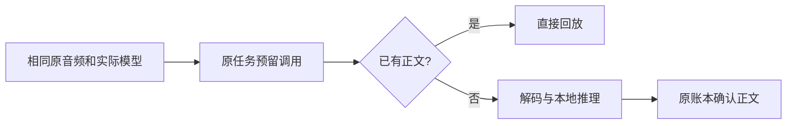

# T-915：本地识别纳入原执行账本

本批补齐 Whisper 适配器的持久调用路径：先查询原回执，再决定是否解码、加载模型和推理。已确认正文直接回放；音频摘要、实际 Xenova 模型名与语言必须和冻结输入一致。本地协议的远端地址摘要为真实 null，不伪造供应商地址或 token 用量。

本地键使用 `/local-asr/1`，云端仍为 `/asr/n`；完整本地输入清单和云端分片清单分别保存在原任务上，没有新增队列或数据表。复用 `requests` 非 token 调用次数计量：本地一次计算消耗原 maxCalls/deadline，reservedTokens 为 0，实际 token 仍为 null；这不表示发生了 HTTP 请求。

普通本地计算返回失败后保存 rejected，只有宿主指定原 retryOfCallId 才能重新尝试，原预算不重置。取消、执行控制异常及开始/结算响应未知仍保留未确认状态，不能自行重算。开始 ACK 丢失不启动推理；结算已写但 ACK 丢失可回读原正文。尚未实现本地进程崩溃后、宿主确认退出的专门重算对账，不把当前保守停止说成自动恢复完成。

未知云调用仍阻止本地新调用；本地不能拿正文结算云调用、新租约不能补造旧开始结果。本地结算禁止声明 HTTP 状态；独立复核指出的这一缺口已修复并覆盖数据库负例。原音频缺失保护也覆盖本地调用与清单。

验证：本地数据库与实际适配器链路最终 8 项；云 ASR 和音频保存回归 24 项；Worker 六文件 64 项，共 96 项不同测试通过。backend、ai-worker、frontend 类型检查均退出 0。本地前三项回放/ACK 测试当场失败后修复；本地重试断言有独立红绿证据。数据库为隔离实例，音频与推理为可控替身，未加载真实模型、访问用户媒体或调用供应商。

未完成范围：生产任务准备、按作品凭据与实际执行选择、完整 Worker 取流/后处理/落稿编排仍未接通。本批仍是 ASR 命名端口和运行时的实现，不代表正式转写入口已经迁移。正式聊天、其余 R-05、旧路径退役、性能基准与双平台验收继续属于 T-915。

工程对账：pmem sync 已运行；reconcile 退出 1，211 errors / 1 warning。T-893/T-900 历史回执从工作区漂移转为提交后代码变化，错误任务未新增或消失；既有欠债继续保留 T-916，不宣称全绿。
