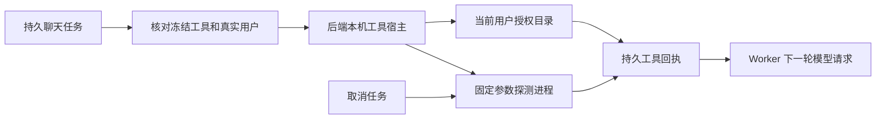

# T-915：聊天本机工具接入与宿主逻辑提取

真实聊天 Worker 可调用本机版本探测和当前用户授权目录读取，并在下一轮模型请求收到原有卡片结果。版本探测从大型前端装配文件移入后端宿主模块，保持工具白名单、固定参数和 3 秒超时。

- local.tools、local.workspace 经统一工具工厂和回执链路执行。工具版本更新为 chat-tools-local-host-v2，旧声明不能静默使用新的错误处理语义。
- 去掉内层吞错，外层旧聊天错误卡片仍兼容；新宿主可保留瞬断分类及取消状态，不在工具内重复重试。
- 账号、用户和声明版本变化、非法输入、提前取消均不得访问宿主；取消信号直达 execFile。授权目录仍属于当前用户，不改变数据归属。
- 只含本机工具的任务不再被无关的 guide Skill 加载阻断。只有实际声明 guide 时才解析对应快照。

当场验证：

- 后端本机/规划/候选工具及旧聊天回归 5 文件 377 项通过；读取工具和定义回归 2 文件 11 项通过。
- 真实版本探测及白名单回归 2 文件 15 项通过，包含实际启动临时探测进程、取消并核对 PID 已退出。进程用例仅在非 Windows 平台运行。初始 1 秒等待不足（单独实测临时脚本启动约 1.12 秒），等待调整为 2.5 秒，仍小于生产 3 秒上限；未放宽生产超时。
- 本轮最初 7 项工具测试失败于无关 guide 快照依赖，不冒充缺少本机工具实现的前置红测。完整工具未接入红测已存在于上一提交。
- 真实独立 Worker 文件 4 passed / 1 failed：新本机场景使用隔离数据库、真实 Node 版本命令和隔离目录授权文件，3 次本地测试模型请求、2 项已结算工具结果，未泄露另一用户目录。完整聊天测试仍实际失败，未裁减声明；缺少 13 项工具且模型请求为 0。
- 真实规划回归 3 项通过；backend/frontend 类型检查通过。独立只读评审未发现具体阻断，评审者未独立运行测试。
- boundary 剩余既有 5 项，无新增；orphan 为 0 errors / 100 warnings。

这不是商业模型或双平台安装包验收。公开聊天入口仍未切换；其余生成、网页、本地文件和素材工具，以及完整性能基准仍待完成，T-915 保持进行中。

最终对账：pmem sync 已执行；reconcile 为 211 errors / 1 warning，与既有基线一致，仍未通过。精确写集预检通过；复杂度记录仅更新既有前端装配文件哈希，没有放宽规则。原始日志保留命令输出及末尾空行。
