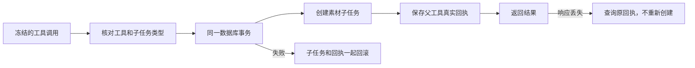

# T-915 素材生成原子提交与恢复基础

本批使已存在的纯事务提交链支持明确的 `material.generate → asset.generate` 映射。协议层、后端提交和租约恢复共用一个映射，避免提交与恢复各自维护允许列表。原 `planning.thesis → planning.thesis` 行为保留，不开放任意子任务类型。

没有回执时，只有确实声明为纯事务提交且没有未知结果、执行 claim、用量或子调用的状态，才允许租约恢复。错误子任务类型在事务内拒绝，创建动作随之回滚。既有普通宿主动作不会因此获得重做资格。

## 真实验证

- `material-atomic-submit-red.log`：新增素材用例 5 项失败，私有协议原来只允许论点工具，拒绝素材提交声明。
- `material-atomic-submit-green.log`：中间尝试仍有 5 项失败，记录未覆盖，不能按文件名宣称通过。
- `material-atomic-submit-final.log`：协议与执行映射共用后 34 项通过。
- `material-atomic-submit-final2.log`：增强 ACK 丢失和错误类型断言后 35 项通过。通过真实数据库、AI service、宿主账本及 Worker 的 `runDurableAgenticTool` 函数验证素材子任务提交、事务回滚、租约恢复、旧 fence 拒绝、并发同参复用、取消与 ACK 丢失恢复。该测试没有 fork Worker，也没有调用生成供应商，不能冒充实际素材生成验收。
- `material-atomic-submit-contract.log`：9 项通过，检查明确映射、拒绝任意名称／原型属性与副作用声明降级。
- 提交后发现新增契约测试意外覆盖了原文件的 5 项用例，已按上一个提交逐字恢复并追加新增测试。`material-atomic-submit-contract-restored.log` 最终 14 项通过，原协议编码、消息归属、结算与完成回执约束未删减。前述 9 项结果不是完整契约回归。
- `material-atomic-submit-types.log`：contract、backend、frontend、ai-worker 类型检查。
- `material-atomic-submit-mixed-setup.log`：混合工具测试最初遗漏额外工具端口，装配校验拒绝；补齐测试端口后，`final2` 已覆盖同一冻结清单同时含论点和素材工具的恢复路径。未放宽完整工具装配校验。
- 独立只读复审确认未放宽 unknown 或普通宿主操作重放；审查者未运行测试。
- `pmem sync` 已运行；`material-atomic-submit-reconcile.log` 仍为既有 211 errors／1 warning。范围与复杂度检查通过；boundary 无新增、剩余 5 条；orphan 为 0 errors／100 warnings。T-915 不标记完成。

## 尚未完成

正式 `material.generate` 工具工厂、当前稿快照与版本核对、素材任务的实际唤醒和生成 Worker 仍需接入，不能把这次基础事务支持写成工具迁移已完成。完整场景仍有 9 项工具未接，默认聊天入口和双平台、真实供应商、性能验收仍未完成。
