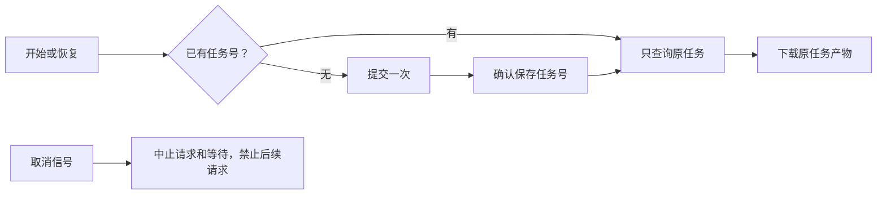

# T-915 MiniMax 视频恢复与取消基础

检查素材 Worker 的依赖时发现：旧版 MiniMax 视频接口忽略 `resumeJobId` 和 `onJobSubmitted`。上层即使持有原任务号，适配器仍会重新 POST；首次提交后也没有在轮询前确认任务号已持久保存。H3 原有这两项行为，本批补齐旧版接口，未增加任何自动重提。

视频选项增加可选取消信号，MiniMax v1 和 H3 将它传入提交、查询、下载和等待。每个新请求前再次检查，等待器即使忽略信号也能及时结束本次调用；默认等待器清理计时器。取消若发生在已经取得任务号之后，仍先允许回调保存已提交事实，再停止后续请求。这是保存实际计费事实，不能丢掉任务号后假装没有提交。

## 验证

- `minimax-video-recovery-red.log`：原实现新增 6 项失败、原 21 项通过；错误日志也保留红测期间提前拒绝产生的异步断言错误，未将它们掩去。
- `minimax-video-recovery-green.log`：修复原号续查、提交确认与取消后首次回归。
- `minimax-video-recovery-final.log`：增加提交确认期间取消、查询正文返回时取消的边界用例。
- `minimax-video-recovery-http-final.log`：最终 42 项通过，包括真实本地 HTTP 请求取消后服务端观察到连接关闭，且只收到查询原 job 的一次 GET。其余供应商响应由注入 fixture 提供。
- `minimax-video-recovery-types.log`：ai-worker 和 backend 类型检查通过；`minimax-video-recovery-http-types.log` 在追加真实 HTTP 用例后再次检查 ai-worker。
- `minimax-video-recovery-runner.log`：既有素材 runner 18 项通过。
- 独立只读复审未发现阻断，确认没有新增计费重提，且取消后保存已收到的任务号符合结算语义。审查者未运行测试。
- `pmem sync` 已运行；`minimax-video-recovery-reconcile.log` 仍为原有 211 errors／1 warning，范围与复杂度、orphan 检查通过，无新增架构违规。全局对账未通过，未标记任务完成。

## 剩余范围

尚未接通正式 runner 的取消信号、独立素材 Worker、execution 账本与候选幂等提交，也没有真实商业供应商或双平台验收。现有 provider 接口的全部错误分类、其他厂商取消实现仍需随迁移核对。本批不宣称跨进程恢复已完成；T-915 保持进行中。
