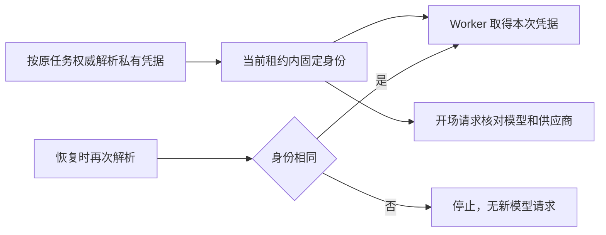

# T-915：实际模型身份固定与开场请求绑定

真实调度器在返回模型凭据之前，按当前租约把第一次解析的模型身份固定到原执行任务。以后恢复时，模型、端点、协议或结构化能力发生变化会在供应商请求前被拒绝；仅 token 轮换可以继续。这个约束已接入共有模型、聊天和 Agent 调度路径，不只是独立 helper。

身份保存在 execution payload 的宿主运行字段 modelIdentity；原 modelInput、hostContext 和其摘要不变。token 不持久化，完整端点 URL 也不持久化，只保存完整端点摘要及是否自定义端点。用户信息或查询参数中的凭据不会随新增身份落库。字段由宿主创建，enqueue 拒绝调用者自报；入队幂等比较排除该运行字段，原请求重放仍返回原任务。

开场生成的操作键包含固定身份，内部请求的 modelId/provider 必须匹配它。映射来自不依赖 SDK 的纯函数；真实 SDK 请求捕获覆盖 anthropic、openai_chat、openai_responses，各自默认/自定义端点和普通/受管模型共 12 种组合。受管模型包装后的显示身份也纳入验证。探测在预留阶段中止，没有联网。

当场测试证据：

- 新模块缺文件的前置失败仅为模块缺失，不标为断言红测。
- 独立评审发现入队幂等冲突和 URL 凭据落库；真实断言为 2 failed / 9 passed，修复后通过。
- 未设置字段经过 JSON 存储后漂移的红测为 1 failed / 11 passed，统一规范化后通过。
- 开场冒用 modelId/provider 的红测为 2 failed / 21 passed，接入固定身份后通过。
- 身份、开场、持久任务三文件 43 项；真实模型调度器 8 项；聊天与 Agent Worker 调度 31 项；真实只读宿主装配 2 项；Worker 协议身份测试 3 项，共 87 项通过。
- 真实 Worker 先固定身份、暂停、恢复，再由凭据解析器返回另一模型：任务明确失败，供应商 HTTP 请求为 0。原模型生成、429 恢复与取消测试仍通过。
- 三包与前端类型检查通过；边界保留既有 5 条、无新增；orphan 0 errors / 100 warnings。
- 独立只读评审最终未发现新增阻断；评审者没有另行运行测试。测试均使用隔离数据或本地 HTTP fixture，不是商业供应商或安装包验收。

历史任务缺少 modelIdentity 时，第一次固定仍依赖原凭据解析器的权威约定，不能反推历史请求的真实模型。本批没有接通 hooks 的 Worker 命名端口、冷启动父候选恢复或正式 /api/chat 切换；这些继续作为 T-915 未完成范围推进。

pmem sync 完成；全局 reconcile 仍为 211 errors / 1 warning，本批范围与复杂度检查通过。原始输出见 model-identity.reconcile.log，原 T-916 欠债继续保留。
