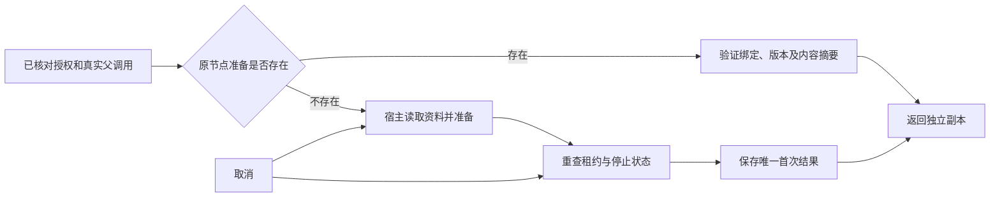

# T-915：首次生成准备结果持久冻结

开场生成第一次准备成功后，将提示词、系统提示和可溯依据保存到原 execution_tasks 的私有 payload。后续预留、完成和恢复读取同一份准备结果，不再因重新拼接提示词改变原模型调用身份。

- 共用准备服务以父工具 ID、输入摘要和节点版本定位记录，回读再校验内容摘要及调用者提供的严格 schema。当前 hooks 使用只包含 prompt、system、grounding 的 schema。
- 数据保存在现有后端任务表；不增加数据库、队列或通用 Worker 执行权限。模型身份和输出预算继续使用原冻结配置。
- 不在等待读取时持有事务；提交前重新验证父调用、原输入、当前租约和取消状态。并发准备只能保存一个胜者，其他调用返回已保存结果的副本，迟到内容不能覆盖。
- 复用 awaitPreparation 结束取消后的等待，拒绝迟到结果。该机制不宣称能强制终止不支持 AbortSignal 的底层读取；准备回调仅限无副作用读取。
- 通用服务不替代工具授权和当前回合检查；hooks 仍在调用前执行原真实绑定、授权、模型身份校验。

当场验证包括实际数据库回读、重建服务后不调用准备函数、返回对象隔离、并发胜者、错误父调用/摘要、保存数据或版本改变、取消和迟到数据拒绝。挂起准备取消用例先出现实际红测（取消后仍等待），随后接入现有 awaitPreparation 后通过；其余是实现后回归，不补称前置红测。

独立只读复核未发现实际阻断，评审者未运行测试。共享子模型端口、选题和定位的专属凭据与候选投影仍未接通；本批不能代表这两项已完成 Worker 迁移。完整 T-915 仍在进行中。

本轮最终专项测试：hooks 服务 50 项与真实独立 Worker 13 项，共 63 项通过；backend 类型检查通过。本地测试模型不作为商业供应商或双平台验收。boundary 剩余既有 5 项，无新增；orphan 为 0 errors / 100 warnings。精确写集预检通过。

最终对账：pmem sync 已执行，reconcile 为 211 errors / 1 warning，与既有基线一致，仍未通过。
