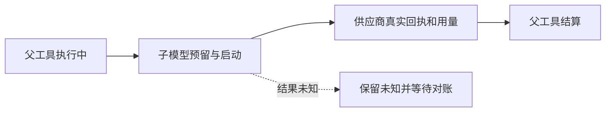

# T-915：持久账本的父子模型调用归属

执行账本新增可空 parentCallId，自引用外键随 0084 正式迁移加入。旧调用为空，模型调用只能属于同一任务的顶层工具；只有当前租约正在执行的父工具能创建或启动子模型。相同操作键不能换父、改变输入或把子调用变成顶层调用，父工具结束后只能回放已有子回执。

父子调用使用同一调用次数、用量和截止时间。子模型成功须有供应商回执，父工具结算前所有子调用须已确认且用量已知，或属于明确未执行的拒绝。独立评审发现父工具能在子调用后伪装成 rejected 并重试整树，前置反例失败后已修复：只要存在子调用，就禁止父 rejected；仍允许记录 unknown。原顶层模型结算不额外读取子树。

本次没有开放 Worker 子模型端口，也没有改聊天投影或放宽旧 attempt 恢复。已有模型端口严格拒绝 Worker 自报 parentCallId；账本底座不是工具授权，后续窄端口仍须核验真实冻结工具、模型能力和候选结果。公共聊天入口尚未迁移。

验证：初始 3 failed / 9 passed，缺父归属字段；独立评审反例为 1 failed / 20 skipped。最终账本 22 项通过，覆盖父身份、禁止递归、同键归属、并发关闭、token/次数共享、拒绝重试、未知/缺用量、取消、旧 attempt、Worker 输入边界以及隔离数据库旧表升级和重复迁移。六文件回归 103 项通过，另新增升级测试通过，合计 104 个不同用例；未测试商业模型和用户数据库。

扩大回归时，旧真实 Worker 测试先出现 2 failed / 100 passed，单文件复查同样失败。查明其夹具漏接 Worker 已在使用的 appendStreamEvents，补接正式 createExecutionStreamService 后恢复路径通过，未以虚假响应放行。该夹具修复与父子账本逻辑分开可审查。

backend/frontend 类型检查通过。独立只读代码复核无未决阻断，评审者未另行重跑测试。边界无新增违规（既有 5 条）；orphan 0 errors / 100 warnings。pmem sync 已完成并刷新 CodeGraph。本次全局 reconcile 仍为 211 errors / 1 warning，未通过，保留 T-916 工程债务和 T-915 全部待验范围；没有把整体任务标为完成。
