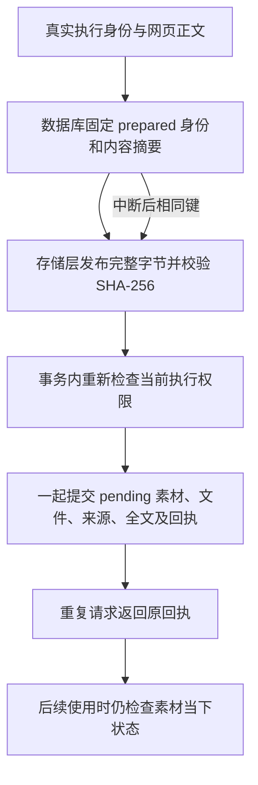

# T-915 待确认网页正文的可恢复提交

本批实现 assets 模块内部提交服务，承接 SPEC R-03 的跨事务产物幂等要求，为正式聊天 `web.read` 迁移提供落库端口。旧网页读取装配尚未切换，不能把本批测试当成完整 Worker 旅程验收。

## 行为与属主

`createPendingDocumentService` 接收 backend 恢复的 RequestContext、真实调用/证据派生的 operationKey 与已观察的正文。首次异步操作前固定身份和输入；必填 `authorize` 由 backend 执行属主在数据库事务内重查权限、租约及停止状态。Worker 不获得数据库或该回调。

- 新表 `pending_document_commits` 与迁移 `0085` 保留 prepared/committed 事实。身份由 user/account/operationKey 的 SHA-256 固定；同键异标题、来源或正文拒绝。来源只接受不含凭据的 HTTP(S) URL；UTF-8 正文上限 2 MiB。
- 存储路径包含账号分区及完整身份摘要，先固定数据库胜者，再使用胜者的 assetId/fileId/storageKey。已有完整字节复用；长度/摘要不符时拒绝，不覆盖冲突对象。
- 创建 pending asset、首版文件、currentFileId、sourceUrl、extractedText/done 和 committedAt 在同一事务内完成。事务内没有大文件 IO。prepare/commit 均先执行授权，再取得回执行锁。
- 已提交回执优先返回，不读取或重写字节，不因用户后续采纳、改名、切换文件或删除而创建新素材。回执只说明历史提交事实；未来卡片投影必须读取素材当下状态，不能凭历史回执宣称删除的素材仍可读。
- 本地 `putObject` 改为同目录临时文件完整写入并 sync、rename 后发布；字节与 sidecar 分别原子发布。避免失败重试截断已发布完整对象。不宣称未经验证的断电持久性：rename 后没有父目录 fsync，Windows 真机也未在本批验证。
- prepared 行与准备对象保留供恢复，不按 TTL 删除或换身份。进程硬杀可能留下临时文件；本批未实现其清理，不把它写成零孤立文件保证。

## 当场证据

- [红测日志](pending-document-red.log)：修改前原子写测试实际得到“半份”而非“完整正文”；新提交服务套件因尚不存在 schema/service 无法导入。后者是能力缺失证据，不伪称原有实现的行为红测。
- [最终回归](pending-document-green.log)：**66 passed / 5 files**。含新增正文服务 14 项、本地原子写 1 项、既有本地存储 9 项、原素材服务 30 项、当前版本缓存 12 项。
- 新测试使用真实隔离 PGlite 和实际临时目录字节存储：注入写后异常、文件 INSERT 触发器失败（验证 asset 回滚）、回执重放、强制两个服务同时读到 missing 后两次同键 put、并发异正文、损坏字节拒绝、准备期间取消、跨用户/账号隔离、参数上限、输入和账号异步变化。
- 磁盘 PGlite 实际关闭并重开两次，验证准备回执恢复、已提交回放及迁移重复启动。提交 ACK 丢失测试是丢弃已返回结果再重放的服务级模拟，非真实父子进程通信断线；未冒充 kill-process 测试。
- [backend 类型检查](pending-document-typecheck.log) 通过。精确 write-set preflight 通过。
- `worker_review` 独立只读复核最终代码，无剩余具体阻断；其身份快照及锁顺序建议已落实并回归。审查不包含断电、双平台、商业 S3 或实际 execution 接线验收。
- boundary：基线 5，无新增。orphan：0 errors / 100 warnings。`pmem sync` 已运行；本轮全局 reconcile **211 errors / 1 warning**，与既有失败数量一致。未把服务测试通过写成 T-915 全量完成，任务保持进行中。

## 接线时必须保留

后续 execution 端口只能从真实父调用、冻结 URL 与持久正文证据派生提交键和输入，绑定实际事务授权守卫。prepared/字节存在不代表新执行授权。网页读取仍须保留正文窗口、来源、不可信内容包装、登录恢复、blocked/alternates 与用户采纳语义；本批没有替换原入口或接通这些行为。
