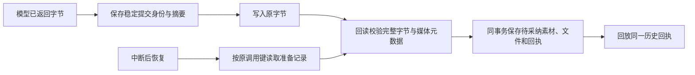

# T-915 生成素材的幂等保存与恢复

本批为图片和视频增加稳定提交回执。账号、用户和后端原调用键共同派生素材 ID、文件 ID 与对象键；内容摘要固定真实字节和展示信息。准备记录保存在独立表，沿用既有对象存储与素材服务边界，不修改网页文本提交路径。

`submit` 在首次等待前复制上下文、输入和二进制字节。`recover` 只需要服务端原调用键，不接受任意文件路径，也不调用模型；没有记录返回 missing，记录存在但对象缺失返回 bytes_missing，损坏摘要和存储故障明确报错。已保存完整字节后，重新装配服务可以恢复同一份素材。

复审发现本地对象可能在字节发布后、元数据 sidecar 发布前中断。本批在完整字节摘要匹配后，用原回执 MIME／类型和原字节补齐存储元数据，再重新校验；此过程不会调用模型生成。宽高、时长与媒体元数据继续来自 objectStorage 的实际 headObject。素材始终为 pending，不能通过输入变成 active。

提交权限由必填后端回调在事务内校验，锁序保持执行权限在前、提交记录在后；准备和恢复读取对象前检查权限，创建素材前重新检查取消。素材、文件和完成回执一同提交，失败整体回滚。已完成回执作为历史事实保留，用户后来改名或删除素材时不会重建、覆盖或重新读取对象；调用端仍须核验原调用归属。

## 实际验证

- `pending-generated-asset-red.log`：新服务／schema 尚不存在导致测试导入失败，不宣称行为红测已经运行。
- `pending-generated-asset-first.log`：首批 8 项本地数据库与真实 LocalFS 测试通过。
- `pending-generated-asset-final.log`：增加取消、授权与迁移重跑后，连同原文本提交和素材 runner 共 43 项通过。
- `pending-generated-asset-sidecar-red.log`：独立复审发现的 sidecar 中断窗口发生 1 项真实行为红测失败。
- `pending-generated-asset-sidecar-final.log`：修复元数据补齐后最终 44 项通过。
- `pending-generated-asset-types.log`：首次 backend 类型检查通过；`pending-generated-asset-types-final.log`：最终 backend／frontend 类型检查通过。
- 独立只读复审确认 sidecar 中断阻断已解除，取消检查已补齐；审查者未重复运行测试。
- 迁移 0088 在测试数据库中重复执行两次，已提交回执和素材保持原值；没有对用户实际数据库执行迁移。
- 本轮开工时 context-compile 发现上轮证据文档的 IPC 复杂度未登记，已按文件真实哈希补入 COMPLEXITY_LEDGER，绑定原 DEC-RUNTIME-055；未通过删除描述绕过门卫。
- 本轮 `pmem sync` 已运行；`pending-generated-asset-reconcile.log` 保持现有 211 errors／1 warning，范围与复杂度、orphan 检查通过，无新增架构违规。后续最终 preflight 也通过，全局对账仍未通过。

## 仍未完成

素材 Worker 的调用、产物传输、任务账本结算和候选提交尚未接通。特别是模型已经返回、准备回执还未保存就崩溃的窗口，本服务不能恢复；执行账本必须保留未知，不能重新付费生成。上述验证没有调用商业供应商，也不构成杀 Worker／父进程或双平台安装包验收。T-915 继续进行。
