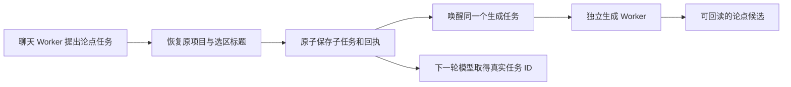

# T-915：论点真实工具工厂与提交后唤醒

真实论点工具已装配到持久聊天工具工厂。专项使用真实数据库、聊天 Worker、生成 Worker 和候选回读；模型 HTTP 是本地测试服务，不是商业模型验收。完整聊天场景仍失败，未接工具从 16 项降到 15 项；公开聊天尚未切换。

改动：

- `prepareDurableChatTurn` 为 planning.thesis 冻结独立版本的 host.task-submit；旧普通准备默认声明不变。原生参数、描述、权限规则均复用。
- `createChatTaskToolHost` 可注入真实纯准备与唤醒端口。工厂每次准备重新核对账号和完整冻结定义，不装配旧模型执行闭包。项目使用显式输入或原项目，主题使用显式输入或原选区标题。
- 提交成功和原调用回读均可唤醒原子提交回执里的真实子任务。失败、拒绝、未知回执不唤醒；唤醒异常不改写已落库的成功事实。
- `wakeChatPlanningTask` 经 AI service 回读账号归属、任务类型与状态，再交给既有 structured business prepare 和 model worker；不再次创建任务。

当场证据：

- 工厂 7 项红测先发生再实现。最初 fixture 缺 skillSnapshot 导致非目标错误，补全后重新红测，保留的是后者真实“缺事务声明/端口”失败。唤醒断点测试属于实现后补充回归，不声称先红。
- backend 六文件 97 项通过；包含工厂、原工具定义、候选、原子提交、权限和 hooks 服务。独立 Worker hooks 另 13 项通过。
- frontend 论点专项两项通过：旧真实派发同键恢复保持可用；新聊天 Worker 经真实宿主创建一个子任务，唤醒另一生成 Worker，候选状态为 awaiting_confirmation，下一轮模型请求含同一 taskId，子任务只调用一次测试模型。专项单工具清单不代替完整场景。
- frontend 完整聊天文件 3 passed / 1 failed；未接工具为 topic.generate、topic.enrich、script.draft、publish.package、cover.generate、knowledge.distill、positioning.generate、calibration.diagnose、material.gather、material.screenshot、web.read、local.read、local.tools、local.workspace、material.generate。模型请求为 0；未裁清单或改预期失败。
- backend/frontend 类型检查通过；boundary 保持既有 5 项；orphan 为 0 errors / 100 warnings。独立只读代码评审未发现本批新增阻断，没有独立重跑测试。
- persistence-client 原复杂度条目仅重新绑定当前文件精确哈希，未改变规则或授权范围。

未完成：首次唤醒失败且没有后续回读时，活进程尚无持续补偿；目前仅保留 queued 及启动恢复。后续须接既有调度器领取循环，包括另一长任务占用时仍能恢复、有界扫描、原任务期限和停止等待。其他 15 项工具、公开入口切换、R-05 全迁移、性能比较、商业供应商和双平台验收仍在 T-915 完整范围内。

最终对账：pmem sync 已运行；reconcile 实测 211 errors / 1 warning，与既有全局基线一致，仍未通过。原始日志附在同目录，不标记 T-915 完成。
